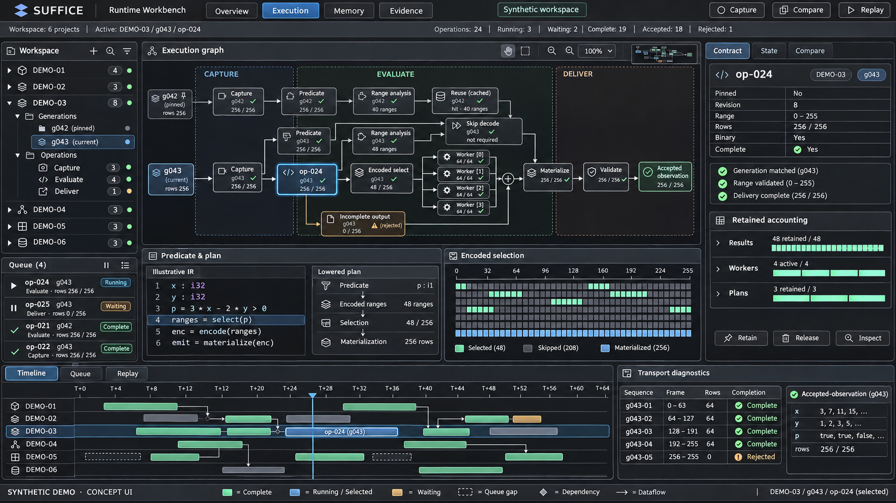

# Suffice


## A dependable foundation for AI agents working on real software

Suffice is a local-first C++20 and Python research runtime for exact predicates and versioned repository observations. It gives developer tools and AI agents an explicit contract for the data they read: **which captured generation it belongs to, what state remains retained, and whether the requested observation was delivered completely.**

Development work unfolds over time. An agent inspects code, plans a change, invokes tools, and returns to earlier observations while the project continues to change. Suffice makes the identity and completion of those observations inspectable, with separate controls for the state kept available for reuse.

**Current status:** runtime **0.13.0**, a separately tested read-only integration bridge, a five-page research paper, and a self-contained evidence-verification notebook. The runtime execution workbench below is a concept UI.

**Start here:** [Paper PDF](paper-packet/paper/Suffice_Paper.pdf) · [Runtime documentation](runtime/README.md) · [Read bridge](paper-packet/integration/README.md) · [Verification notebook](paper-packet/verification/Suffice_Offline_Verification.ipynb) · [Project description](docs/PROJECT_DESCRIPTION.md)

## What works today

- Immutable captured repository generations and pinned reads from a selected generation.
- A persistent native catalog and explicit retention budgets for results, workers, and plans.
- JSONL/hex and SFC1 binary response transports with strict framing and completion checks.
- A Python client that preserves row order, paths, and complete body bytes across transports.
- An agent-facing bridge that accepts only host-approved scopes and bounded generation-local row ranges, then checks completion, identity, and retirement policy before releasing an observation.
- Exact predicate execution, intermediate representation, residual specialization, and code-generation research retained in the core implementation and its earlier release lineage.

The design keeps **generation identity, retained state, and complete delivery** separate. A pinned generation identifies captured data; it does not prove that the live worktree is unchanged. Retention accounting is not a whole-process memory ceiling. The bridge stages an accepted observation privately; the underlying pipe can still fail after emitting a prefix.

## Verify the evidence first

From the repository root, with **Python 3.12 or later**:

```bash
python3 paper-packet/verification/run_offline_audit.py \
  --report paper-packet/verification/local_audit.json
```

This uses only the Python standard library. It checks the retained experiment records, source/input identities, schedule, resource accounting, and paired arithmetic. It does not run a model or native executable, reproduce historical timing, or require an API key, GPU, or internet connection. Use a fresh report path on each run.

The [notebook](paper-packet/verification/Suffice_Offline_Verification.ipynb) embeds the same evidence and verifier. Its five code cells can be executed in order; the [verification guide](paper-packet/verification/README.md) explains the recorded execution and the audit's limits.

## Build and run the integration checks

Native builds require a **C++20 compiler, its archiver, and native Zstandard headers/library**. Capture and fixture-producing integration tests also require the Python `zstandard` package. The builder installs or downloads nothing. Its native correctness and CLI gates run by default.

Run from the repository root, using fresh `local_*` output paths:

```bash
python3 runtime/scripts/build_payload.py \
  --output runtime/build/local_release

python3 runtime/tests/test_catalog_framing.py \
  --json runtime/results/local_client_framing/RESULT.json

python3 runtime/tests/test_transport_integration.py \
  --binary runtime/build/local_release/suffice_catalog \
  --packer runtime/build/local_release/suffice \
  --output runtime/results/local_transport_integration

python3 paper-packet/integration/test_repository_read_bridge.py \
  --runtime runtime \
  --binary runtime/build/local_release/suffice_catalog \
  --packer runtime/build/local_release/suffice \
  --output paper-packet/integration/validation_new
```

See the [runtime quickstart](runtime/README.md#linux-quickstart) for producer, catalog, worker, capture, and sanitizer commands. These root-relative commands account for this repository's layout; the unchanged paper packet also contains examples for its original extracted-release layout.

The [Windows 11 workflow](runtime/scripts/run_windows_v0_13.ps1) is supplied but **has not been executed**. The retained results are from Linux. CMake configuration is included, while the recorded release used the direct Python builder.

## Recorded transport results

The frozen study contains **100 fresh processes**, **50 matched process pairs**, and **4,840 complete-output checks**. Its corpus is **103 original files partitioned into 12 logical projects**, not 12 independent repositories.

| Scenario | Geometric JSONL / binary service ratio | Pairs favoring binary | Mean response-byte reduction |
|---|---:|---:|---:|
| Reuse | 2.138× | 10/10 | 49.59% |
| Scan pressure | 1.799× | 10/10 | 49.57% |
| Mixed queries | 1.902× | 10/10 | 49.45% |
| Computed requests | 2.028× | 10/10 | 49.59% |
| Empty output | 1.070× | 4/10 | −2.30% |

Ratios above one favor binary. Service time covers process startup through shutdown, less explicitly timed audit intervals. **Empty output shows no consistent timing advantage:** its paired median ratio is 0.991 and binary sends about 2.30% more bytes. Every observation, including unfavorable results, is retained.

These are descriptive measurements on one shared pinned Linux configuration. They do not establish whole-agent acceleration, token savings, native Windows performance, or a 10× improvement. The later read bridge's overhead is not part of this timing experiment. Its separate native validation recorded **114 checks across four processes**, including six byte-identical cross-transport observations and failures after actual partial output.

Sources: [measurement method](runtime/docs/transport_experiment_v0_13.md), [summary](runtime/results/transport_v0_13/SUMMARY.json), [full report](runtime/REPORT.md), and [bridge receipt](paper-packet/integration/validation_native/RESULT.json).

## Repository guide

| Location | Contents |
|---|---|
| `runtime/src`, `runtime/include`, `runtime/apps` | Browsable native runtime, payload, and catalog source |
| `runtime/scripts`, `runtime/tests`, `runtime/examples` | Build/capture/client tools, tests, and example predicates |
| `runtime/docs`, `runtime/research` | Architecture, wire contracts, methods, and research catalogs |
| `runtime/results`, `runtime/validation`, retained `runtime/build` logs | Frozen measurements and historical validation evidence |
| `paper-packet/integration` | Agent-facing repository read bridge, schema, tests, and receipts |
| `paper-packet/paper` | PDF, editable DOCX, canonical Markdown manuscript, and figures |
| `paper-packet/verification` | Offline evidence, notebook, verifier, and audit receipts |
| `paper-packet/source`, `runtime/baseline` | Unmodified full release archives and earlier lineage |
| `assets`, `docs` | Project imagery, product description, and publication notes |

## Runtime execution workbench



**Synthetic demo and concept UI; the interface is not implemented.** The proposed workbench brings captured generations, execution graphs, predicate plans, encoded selections, delivery validation, and retained accounting into one inspectable workspace. See [workbench scope](docs/RUNTIME_WORKBENCH.md) for the distinction between existing runtime behavior and proposed interface features.

## Engineering boundaries and next steps

The current runtime assumes trusted local storage, coherent capture, and serialized callers. It does not provide atomic filesystem-wide capture, general concurrent scheduling, request deadlines, a sandbox, edit barriers, whole-process RSS bounds, or a full coding agent. Gemma inference and model-level task-success improvement have not been validated. The next platform gates include native Windows execution, completion-aware liveness, and measured process memory behavior. The [handoff](runtime/PROJECT_HANDOFF.md) records the remaining work.

## License and provenance

Existing project code and documentation retain the [MIT license](LICENSE); separately obtained dependencies retain their own licenses. Research catalogs provide source links and paraphrases. AI assistance supported implementation, research, analysis, reviews, and writing; the included reviews are not external human peer review. The paper packet does not establish a Kaggle submission or acceptance.

The expanded runtime preserves source and evidence bytes. Two platform-specific executables are omitted from the browsable tree and remain available inside the unchanged release archive. [Publication provenance](docs/PUBLICATION.md) records this packaging decision.
