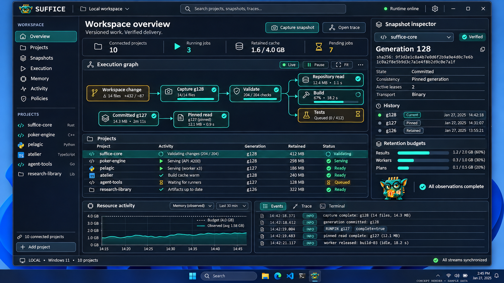

# Desktop concept

This image is a generated visualization of the intended finished desktop product, not a screenshot of running software. All projects, language labels, dates, counts, memory values, task states, and charts in the rendering are illustrative. The implemented runtime is C++20 and Python; a language label in the concept image is not implementation evidence.

The proposed interface includes project navigation, captured-generation inspection, pinned-read visibility, separate retention budgets, task graphs, resource monitoring, and an event console. Snapshot/generation identity, retained-state controls, and read-delivery validation have an implemented runtime foundation. The desktop shell, general build/test orchestration, multi-project scheduler, and live GUI telemetry are future product work.

The image does not establish native Windows compatibility, performance, memory ceilings, model inference, or task-success results. See the [project README](../README.md) for executed work and evidence.

The Byte Gremlin mascot and banner are generated project artwork. Their presence carries no benchmark or functionality claim.
