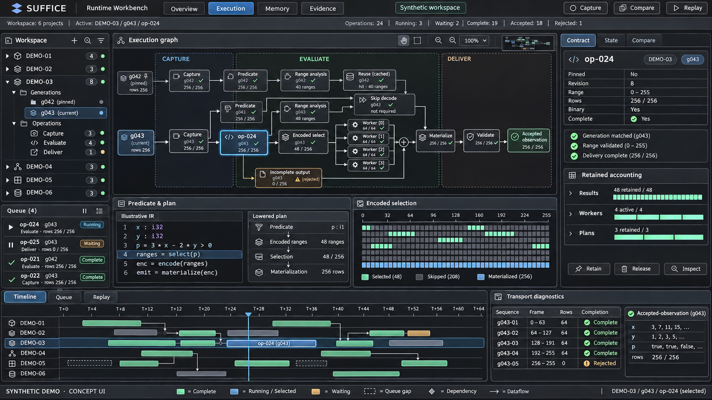

# Suffice

## A dependable foundation for AI agents working on real software

Suffice is a local-first runtime for keeping developer tools and AI agents grounded in explicit, verifiable versions of project data. It addresses a fundamental problem in automated development: the project can change while the work is still in progress.

An agent reads code, forms a plan, calls tools, and returns to earlier observations. Meanwhile, files change, tasks overlap, retained data is evicted, and responses can arrive only partially. Reliable reasoning depends on making those conditions visible. The agent needs to know which version it read, whether that version remains available, and whether its observation is complete.

Suffice makes those questions part of the runtime's contract. Its core combines immutable repository generations, pinned reads, independently controlled retention budgets, and explicit delivery validation. A task can keep reading a selected captured generation as newer generations become available. Retained results, workers, and plans have separate budgets. An agent-facing read bridge checks completion and generation identity before releasing an observation to its caller. These mechanisms establish a concrete connection between the data an agent receives and the recorded state that produced it.

The broader product vision is a runtime execution workbench for sustained work across multiple projects. Captured generations, execution graphs, predicate plans, encoded selections, delivery validation, and retained accounting would be visible together, giving the developer a clear way to inspect what each operation is reading, how its output is produced, and why state remains available. The implemented runtime and read bridge provide the foundation for that workbench.

This workbench design is a synthetic demo and concept UI with illustrative projects, operations, counts, and telemetry. The interface is not implemented; see [workbench scope](RUNTIME_WORKBENCH.md) for its relationship to the existing runtime.

Suffice's ambition is to make complex development work easier to trust, inspect, and repeat. Its design brings explicit versioning and resource control to the boundary where agents encounter project data, supporting longer workflows without allowing the assumptions behind their observations to disappear into the background.

Technical basis: [runtime documentation](../runtime/README.md), [read bridge](../paper-packet/integration/README.md), and [research paper](../paper-packet/paper/Suffice_Paper.pdf).

## Short description

Suffice is a local-first runtime that gives developer tools and AI agents verifiable access to versioned project data. It combines immutable captures, pinned reads, controlled retention, and validated delivery, forming the foundation for a runtime execution workbench where complex development work can remain consistent and inspectable as projects change.
