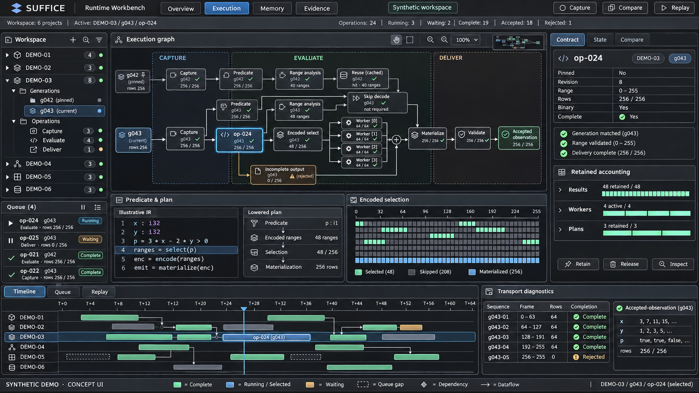

# Runtime execution workbench

This design is a synthetic demo and concept UI, not a screenshot of running software. Its projects, generations, operations, row counts, timings, and status indicators are illustrative.

The proposed interface follows capture, evaluation, and delivery through an execution graph. It shows pinned and current generations, predicate and lowered plans, encoded selections, worker output, materialization, validation, and accepted observations. Contract details, separate retained accounting for results, workers, and plans, an execution timeline, and transport diagnostics make operation identity and completion visible.

Immutable generations, pinned reads, predicate execution, separate retention controls, and read-delivery validation have an implemented runtime foundation. The graphical workbench, interactive execution graph, multi-project scheduler, replay controls, and live telemetry are future product work. The synthetic display does not establish concurrent scheduling or other capabilities beyond the documented runtime.

The image does not establish native Windows compatibility, performance, memory ceilings, model inference, or task-success results. See the [project README](../README.md) for executed work and evidence.

The Byte Gremlin mascot and banner are generated project artwork. Their presence carries no benchmark or functionality claim.
