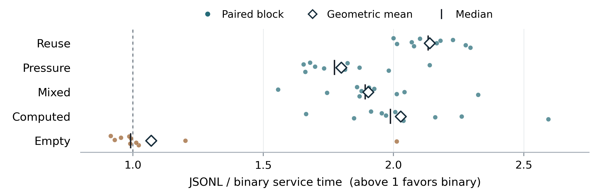

# Suffice Exact Repository Observations for Developer Agents

*Separating generation identity retained state and complete delivery*

## Abstract

Repository tools determine which project state a coding agent observes and how much work each observation costs. Cache-lookup microbenchmarks can omit generation admission, retained-state costs, output encoding, and consumer materialization. We present Suffice, a C++20/Python research resource that couples immutable generations, exact predicate and range identity, independently bounded retention, and validated response completion. In a controlled backend experiment, 100 fresh processes execute 4,840 requests whose ordered paths and complete bodies match an independent original-byte oracle. Binary responses reduce complete-session response bytes by 49.45-49.59% and measured service time by 44.43-53.23% across four nonempty workloads. An empty-output control increases bytes by 2.30% and shows no consistent timing advantage. A separately tested completed-read bridge exposes generation-scoped results through a model-callable interface. The contribution is an executable observation contract and auditable evaluation resource. Bridge latency, Gemma inference, token savings, and issue-resolution gains remain unmeasured.

## 1 Introduction

Local coding agents repeatedly inspect repositories while editing them. A fast read can still be wrong for the intended revision, and a fast cache hit can still spend most of its time serializing and delivering the answer. These are separate correctness and performance questions.

Agent-computer interfaces influence software-engineering behavior [1]. Recent work also identifies stale repository context as a distinct failure mechanism in code completion [2]. Suffice addresses a narrower systems question: how can repository reads be reused and transported while preserving an explicitly defined observation?

We contribute an inspectable implementation with three properties. First, generation, predicate source, and requested range identify reusable output. Second, query plans, execution Workers, and complete results have separate retention lifetimes. Third, a successful observation requires complete rows and a reconciled terminal response. The accompanying benchmark holds this observation fixed while changing response encoding. Its negative control identifies when the optimization has no payload to save.

The research target is a reusable backend for developer-agent tools, especially when several projects share one machine. This paper evaluates the backend and a narrow tool bridge. It does not evaluate a complete coding agent or establish superiority over existing repository tools.

## 2 Observation contract and runtime

### Generation identity

For immutable generation G, exact predicate-source bytes q, and global row range R, define the observation as an ordered sequence:

$$
\mathcal{O}(G,q,R)=[(r_i,p_i,b_i)]_{i=1}^{m}.
$$

Here r is a generation-local row ID, p its relative path, and b its complete original body. The complete-result key retains generation ownership, q, and R. Similar predicates, matching dimensions, or equal row numbers do not establish this identity.

Capture preserves original bytes and four integer features: body length, versioned extension class, LF count, and UTF-8 validity without NUL. Native disk admission checks component hashes, paths, payload structure, raw/packed agreement, decoded lengths, and body hashes; it independently re-derives the features. A corruption test refreshes hashes around a false feature and still fails admission. Internally consistent metadata therefore cannot certify its own semantics.

OPEN validates a captured generation before publication under an expected in-memory revision. PIN retains that generation; RUNPIN reads it even after the named project changes. A pinned generation is consistent, not necessarily current. Disk generation labels and native revisions have different scopes. Capture assumes a quiescent source: checked individual reads do not provide a filesystem-wide transaction.

### Retention and construction

Prepared queries can survive Worker eviction. Computed reads acquire execution state; complete-result hits need no Worker. A scope guard remeasures retained Worker components after successful and exceptional exits, enforcing independent byte and entry caps. Current and retired generation owners remain accounted for until released.

Explicit Populate uses Capture: normal decoding delivers each selected body and copies it into a private candidate. Publication occurs only after complete execution. Optional candidate allocation failure permits uncached delivery; sink or decode failure prevents publication. A replacement node is staged before victims are evicted. These mechanisms preserve useful output while separating retention policy from answer validity.

The budgets cover named retained components at settled operation boundaries. They do not bound transient candidates, Python objects, allocator overhead, or whole-process resident memory. Operations require caller serialization.

### Completion and transport

A successful response must satisfy the following specification for transport T:

$$
\operatorname{success}(W_T)\Longrightarrow D_T(W_T)=\mathcal{O}(G,q,R).
$$

W is the complete response transcript and D its decoder. This is a specification supported by executable checks, not a machine-checked proof. The experiment's independent oracle establishes body equality for measured requests; the normal client validates framing and metadata without independently authenticating every body against repository originals.

JSONL carries hex paths and bodies. SFC1 binary responses use a 16-byte versioned header and 32-byte row prefix, followed by raw UTF-8 path and body bytes. A row occupies exactly 48 + path bytes + body bytes. The payload limit is 4 MiB; paths are nonempty, NUL-free, and at most 32,768 bytes. Ordinary admitted bodies are capped at 1 MiB. Requests retain the same bounded TAB/LF protocol.

The reader checks extents before variable reads, handles fragmentation, and reconciles sequences, row order, requested ranges, output budgets, and terminal counts. A short native write or failed flush permanently poisons the writer; appending an ordinary error cannot repair a partial frame. Malformed responses and callback failures close the child. Fully validated application errors can remain recoverable. JSONL remains the default; binary is explicit.

## 3 A completed read interface for Gemma tools

Gemma 4 supports structured function calling, while the application remains responsible for validating and executing proposed calls [3]. The supplied bridge places Suffice at that application boundary. The host selects and pins admitted generations. Its read_repository(scope, generation, first, count, max_bytes) tool uses a fixed all-row predicate and bypasses result caching. Arguments select host-approved scopes and bounded generation-local row ranges; they cannot introduce filesystem roots or arbitrary predicates. Path search and semantic retrieval are not implemented.

The bridge collects the entire response privately and creates a tool observation only after successful terminal validation. It renders exact bodies as UTF-8 when valid and otherwise as explicitly tagged base64. Timing and wire metadata are excluded from deterministic tool content. Equivalent reads through both transports should therefore yield identical model-visible text. Reduced pipe bytes do not imply fewer model tokens.

After the host publishes a newer generation, the bridge rejects reads through retired scopes unless the host explicitly approved historical access. It also rejects a supplied generation token that differs from the scope. The host must manage edits, recapture and admission. The bridge cannot detect arbitrary external edits or implement an agent controller. Repository text remains untrusted data; exact bytes are not protection against prompt injection.

This bridge was added after the frozen 0.13 transport experiment. Its additional validation, hashing and rendering costs were not timed there. Gemma invocation and task-level evaluation remain future work.

## 4 Experimental method

The primary experiment compares JSONL and binary responses in one 0.13 binary and one Python client. Capture, cache policies, native ordered FNV consumption, output representation, and semantic validation are identical. Every process fully admits twelve generations before its trace.

The preserved corpus contains 103 source files and 1,460,207 original bytes, partitioned round-robin into twelve logical projects. These are pieces of one tree, not independent repositories. All 187 original body/store inputs are copied without recapture. The oracle sorts original UTF-8 paths and evaluates body length directly, independently of packed features, then compares every returned row, path, and byte.

*Table 1. Fixed traces used in each fresh process.*

| Workload | Queries | Policy and purpose |
|---|---:|---|
| Reuse | 48 | Populate, four project cycles |
| Pressure | 26 | Populate, hot pair interrupted by a scan |
| Mixed | 72 | Populate, three thresholds repeated |
| Computed | 48 | Bypass, recompute every result |
| Empty | 48 | Bypass, independently verified empty selection |

Reuse, Pressure, and Computed use length >1,024 bytes. Mixed uses thresholds 1,024, 8,192, and 65,536; Empty uses 1,073,741,824. Result budgets are 1,457,164, 283,059, and 2,955,422 bytes for the three Populate traces, and zero for Bypass. Worker retention is 16 MiB with 32 entries; plan and result entry caps are 64. Independent models check LRU transitions, occupancy, and retained-state limits after admissions and queries.

Ten repetitions alternate transport order and rotate scenario position. Each scenario has ten matched process pairs, five with each transport first. Runner and child share a pinned logical CPU on Linux; the CPU is not exclusive and filesystem caches are not flushed. The recorded configuration uses GCC 14.2, Python 3.12.14, and native Zstandard 1.5.7.

$$
T_{\mathrm{service}}=T_{\mathrm{spawn\ through\ close}}-T_{\mathrm{timed\ audits}}.
$$

Service includes startup, Full admission, execution, Capture or replay, complete transfer, Python materialization/validation, statistics, and shutdown. Explicit full-byte, descriptor, policy, resource, and row-wire audits are subtracted. Subtraction does not reverse their cache or scheduling effects, so raw wall time is retained. Query-only timing is secondary. Ten process pairs per scenario are the observations; requests are not independent timing replications.

## 5 Results

All 4,840 complete-output checks passed across 100 processes, covering 23,480 rows and 419,571,140 delivered body bytes. Counts include repeated delivery. Native final state and request-byte counts match in every transport pair.

Table 2 reports JSONL time divided by binary time within each repetition, aggregated geometrically. Values above one favor binary. Byte reductions are means of paired complete-session stdout reductions, including controls and QUIT.

*Table 2. Complete-session comparisons from ten matched process pairs per workload.*

| Workload | Service ratio | Raw wall ratio | Binary wins | Fewer response bytes |
|---|---:|---:|---:|---:|
| Reuse | 2.138 | 2.038 | 10/10 | 49.59% |
| Pressure | 1.799 | 1.693 | 10/10 | 49.57% |
| Mixed | 1.902 | 1.830 | 10/10 | 49.45% |
| Computed | 2.028 | 1.947 | 10/10 | 49.59% |
| Empty | 1.070 | 1.070 | 4/10 | -2.30% |

For nonempty workloads, equivalent service reductions are 44.43-53.23%, computed as 1 - 1/ratio. Separate JSONL/binary median times are 75.17/34.76 ms for Reuse and 53.19/29.86 ms for Pressure; dividing separate medians is not the paired estimator. Nonempty service-ratio ranges span 1.556-2.594 across scenarios. Every nonempty raw-wall pair also favors binary.

*Figure 1. Each dot is one paired process block; diamonds are geometric means and short vertical marks are medians. Empty output retains an influential observation. Ranges describe this run and are not confidence intervals.*

The Empty paired median is 0.991, with only four wins. One JSONL session takes 43.347 ms versus 21.548 ms for binary, largely in admission and statistics; its cause is unidentified. Empty output establishes no consistent timing gain. It increases bytes because a 16-byte terminal header replaces one LF without saving any body encoding.

One Pressure binary session contains 19.260 ms of timed auditing: its raw ratio is 1.125 while adjusted service is 1.699. Computed medians differ by order, 2.160 with JSONL first and 1.913 with binary first. All nonempty gains survive both order groups. No observation is discarded.

These results show that complete delivery can remain expensive after query or result reuse. Binary approaches half the body representation size while also removing hex conversion. They do not isolate serialization, parsing, copying, or scheduler costs individually, establish superiority over a mature binary protocol, or imply an application-wide speedup.

## 6 Verification and reproducibility

Release and ASan/UBSan builds each pass ten executable gates. Native writer fixtures exercise 125 checks, 129 expected rejections, and 36 poisoned-stream cases. The final client suite has 26 tests, including 159 fragmentation and 155 truncation positions plus real-child EOF probes. Full integration passes under both transports and builds. Additional fixtures cover empty bodies, every octet, a 1 MiB body, Unicode paths, streaming, ranges, limits, and recovery. Gate counts overlap.

The separate bridge gate passes 114 checks in four native processes, producing twelve complete observations and six byte-identical cross-transport comparisons. Its 36 expected rejections include invalid arguments, retired generations and budgets. Injected prefix failures and terminal-identity mismatches produce no successful partial observation. These checks exercise a tool boundary, not a language model.

The verification notebook includes 187 input files, 78 frozen measurement sources, 100 process records, the build manifest, and a standard-library auditor. Run All verifies identities, original-byte descriptors, schedule, policy/resource accounting, row-wire formulas, cumulative bytes, and published arithmetic without networking or model inference. It checks retained evidence; it does not recreate historical execution or timing. Native reruns use the supplied source and documented compiler/codec environment.

The new application/test targets were compiled against verified unchanged core archives. Implicit system dependencies are not fully hashed, so the build is traceable rather than hermetic. Sanitizer leak detection is disabled and the installed codec is not instrumented. AI assistance supported implementation, analysis, research, and writing; scoped AI-assisted reviews are not external peer review.

## 7 Related work and limits

SWE-agent studies interfaces for autonomous repository work [1]; SWE-bench evaluates issue resolution [4]. Our byte-equality and fault checks establish backend behavior, not solved issues. Weng et al. diagnose stale retrieved context [2]; our generation scopes make version selection explicit but do not guarantee freshness after an external edit. SWE-Pruner reduces task context [5]; Suffice's transport experiment preserves complete selected bodies and makes no token-reduction claim.

CloudBuild already performs content-based reuse under a file-I/O contract [6]. Build Systems a la Carte distinguishes scheduling and rebuilding decisions [7]. Suffice does not invent caching, immutable snapshots, leases, or length-prefixed transport, and it does not discover arbitrary compiler dependencies. Its scoped contribution is an executable combination of observation identity, ownership accounting, completion semantics, fault fixtures, and controlled full-output evidence.

External validity is limited by one corpus, length predicates, a shared Linux CPU, and short serialized sessions. Whole-process memory, native Windows execution, project-update performance, concurrency, model tokens, and agent task success remain unmeasured. Size bounds do not provide request deadlines: stalled live peers and graceful QUIT still require liveness work.

A follow-up should first replay fixed tool traces with identical rendered observations, then run paired Gemma episodes on held-out repositories and mutation tasks. Compare ordinary file tools, generation scopes, retention, and transport separately. Record solved tasks, stale-context incidents, end-to-end time, tokens, and combined process memory; failed and timed-out episodes remain in the denominator. Host-managed edit barriers must be implemented before freshness benefits can be claimed.

## 8 Conclusion

Suffice turns repository reuse into a testable observation contract. Under equal complete output, binary transport materially reduces local service cost in four workloads while an empty control exposes its overhead. The resource enables further agent-tool experiments with version, completion, and accounting boundaries already explicit.

## References

[1] J. Yang et al. SWE-agent: Agent-Computer Interfaces Enable Automated Software Engineering. NeurIPS, 2024. https://doi.org/10.52202/079017-1601

[2] H. Weng et al. When Retrieval Hurts Code Completion: A Diagnostic Study of Stale Repository Context. arXiv:2605.14478, 2026. https://arxiv.org/abs/2605.14478

[3] Google. Function calling with Gemma 4. Developer documentation, accessed November 12, 2026. https://ai.google.dev/gemma/docs/capabilities/text/function-calling-gemma4

[4] C. E. Jimenez et al. SWE-bench: Can Language Models Resolve Real-World GitHub Issues? ICLR, 2024. https://arxiv.org/abs/2310.06770

[5] Y. Wang et al. SWE-Pruner: Self-Adaptive Context Pruning for Coding Agents. arXiv:2601.16746v4, 2026. https://arxiv.org/abs/2601.16746v4

[6] H. Esfahani et al. CloudBuild: Microsoft's Distributed and Caching Build Service. ICSE Companion, 2016. https://doi.org/10.1145/2889160.2889222

[7] A. Mokhov, N. Mitchell, and S. Peyton Jones. Build systems a la carte: Theory and practice. Journal of Functional Programming 30, e11, 2020. https://doi.org/10.1017/S0956796820000088
