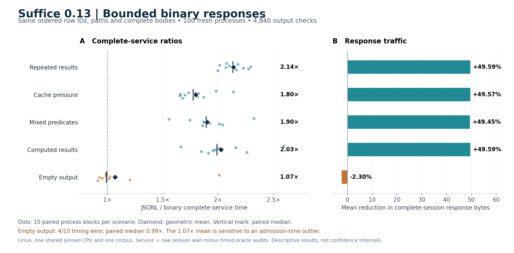

# Suffice 0.13 — Complete-output transport, measured and bounded

**New Runtime Tech · engineering release report · 2026-11-11, America/Chicago**  
Technical execution receipts retain their original UTC timestamps. This report concerns the completed 0.13 Linux experiment. Native Windows execution remains outstanding.

## 1. Outcome

Suffice 0.13 adds an explicit binary response transport while preserving the runtime's complete-output contract: the caller receives the same ordered row IDs, paths and original body bytes. On the retained source corpus, binary transport produced **1.799–2.138× paired-geometric complete-service ratios** across four scenarios returning rows, equivalent to **44.43–53.23% less measured service time**. Complete-session response traffic fell **49.45–49.59%**. Every nonempty scenario favored binary in all ten matched process pairs. These are local observations, not a general application speedup or a Windows result. [E1–E3]

The empty-output control provides a necessary qualification. Binary sent **2.30% more response bytes**. Its paired median service ratio was **0.991×**, and only four of ten timing pairs favored binary. A slow JSONL admission block pulls the geometric ratio to 1.070×; the record does not establish a consistent empty-output performance benefit. All observations, including this block, are retained. [E1, E2, E8]

The completed experiment comprises **100 fresh native processes, 4,840 complete-output checks, 23,480 verified rows and 419,571,140 verified body bytes**. That last count is repeated delivery over traces, not the size of the unique corpus. Native final policy/resource counters and request byte counts agree between every matched transport pair. The experiment used one 0.13 binary and one final Python client, so both arms include the same new semantic validation and control-message assembly. It is not a comparison of old 0.12 JSONL timings with new binary timings. [E1–E3]

The release also closes concrete correctness gaps: a parser cannot trust a declared allocation size before checking it; partial native writes cannot be repaired by appending an ordinary error; a complete native error must reconcile the delivered prefix; hash-mode success/error counts must honor an explicit requested range; and EOF cleanup must not block while draining an open stderr pipe. [E4–E7]

## 2. Continuity and preserved progress

This continuation starts from the verified, completed 0.12 archive. Its SHA-256 is `da69f1f305452e1cffd89ddd50aea1009ba43ab1f7eee3e52624c2b60a170ec8`, and its size is 6,957,408 bytes. The complete unchanged archive is included in `baseline/Suffice_0_12_0.zip`, together with selected predecessor reports and manifests. Earlier releases and the competition-paper lineage remain inside that preserved chain. This is recovery and extension from concrete artifacts; it does not assert that inaccessible chat messages were recovered. [E9]

The runtime direction remains coherent. Immutable admitted generations establish the meaning of a query. Prepared queries, retained Workers and complete result entries remove different kinds of repeated work. Capture records complete results during useful computation. This release then reduces the representation cost of moving those complete results to the caller. It changes the transport layer without replacing bodies with handles, deltas or hashes. The earlier architecture and Worker-retention documents retain their versioned filenames; they are historical design evidence, not fresh 0.13 measurements. [E4, E9]

## 3. What changed

### 3.1 Explicit versioned framing

The native service accepts `--transport jsonl|binary`; JSONL remains the default. `CatalogProcess(..., transport="binary")` selects the new path. The request protocol remains the existing bounded TAB-separated ASCII format with LF and hex-encoded text fields. The choice concerns responses.

Every binary frame begins with the following 16-byte header. The implementation encodes integer fields explicitly in little-endian order; it does not copy a C++ object representation into a pipe. Python uses `<4sBBHQ`, whose size and layout are explicit. Python's documentation distinguishes such external formats from native packing and alignment. [S2]

| Field | Bytes | Contract |
|---|---:|---|
| Magic/version | 4 | ASCII `SFC1` |
| Kind | 1 | 1 = terminal JSON; 2 = complete row |
| Flags | 1 | Zero in this version |
| Reserved | 2 | Zero in this version |
| Payload length | 8 | Unsigned little-endian length, at most 4 MiB |

A row payload has four unsigned 64-bit fields: sequence, row ID, path length and body length. They occupy 32 bytes, followed by the exact UTF-8 path and body. The path is nonempty, NUL-free and at most 32,768 bytes. Payload length must equal `32 + path_length + body_length` exactly. The terminal payload remains a JSON object, without an LF. Full details and failure behavior are in `docs/binary_protocol_v0_13.md`. [E4]

The native writer emits the existing body span directly after a small fixed header/prefix. It avoids constructing a hex representation of the body. The Python consumer still creates byte strings and, in collecting mode, retains returned rows. This is a binary encoding optimization, not a zero-copy implementation or compression scheme. Current admission caps ordinary bodies at 1 MiB; both paths cover the measured inputs. The 4 MiB binary payload and 4 MiB JSONL line limits count different framing overheads, so they are not a claim that the two formats have identical maximum representable bodies. [E4, E5]

### 3.2 Framing and semantic validation

The client reads a bounded header, checks the version, kind and extent, then reads a bounded row prefix before allocating or reading variable fields. An exact-read loop handles fragmented delivery and reports truncation. Python explicitly permits reads to return fewer bytes than requested in relevant stream interfaces, so a single call is not an adequate framing rule. [S1]

Both response paths use the same semantic checks: integers must be genuine nonnegative integers in range, sequences must match, JSON keys must be unique, paths must be valid UTF-8, row order and requested ranges must agree, cumulative output caps must hold, and the terminal response must reconcile selected and delivered counts. A well-formed native error can be recoverable only after this reconciliation. A malformed response, callback exception or framing failure closes the owned child. Nested requests are rejected before consuming a new sequence or writing another request. [E5, E6]

Review exposed a specific hole in diagnostic hash mode: a forged terminal count could exceed an explicit requested row count while remaining within the broader output cap. Both success and error branches now apply the explicit range constraint. Regression fixtures cover zero and one requested row under each transport, including valid controls. Hash mode remains a separate diagnostic contract; it is never substituted for complete output in the performance experiment. [E5, E6]

### 3.3 Failure is a state transition

The native writer becomes permanently unusable after a short write, stream exception or failed flush. Clearing the underlying stream's error flag does not restore protocol synchronization. An ordinary terminal error is not appended after a partial frame. The tests exercise this distinction with intentionally failing stream buffers. Delivered-prefix accounting is also preserved when terminal formatting fails after row output. [E4, E7]

The client no longer tries to drain stderr synchronously after stdout EOF. It closes or terminates the owned child on that fatal path. Real Python-child probes cover stdout closure while stderr stays open. This fixes that cleanup deadlock; it does not provide a general deadline for a live child that never produces more bytes or EOF. Continuous stderr draining and request cancellation remain open engineering work. [E5, E6]

On Windows, serve mode sets both CRT stdin and stdout to `_O_BINARY` before I/O, including the JSONL path so that its wire delimiter remains one LF. Microsoft's documentation explains why text translation otherwise changes CR/LF bytes and requires mode selection before stream I/O. The code is present, and a Windows runner is supplied; neither native Windows execution nor Windows performance has been established here. [S3, E4]

## 4. Experimental design

### 4.1 Same complete task in each arm

The corpus contains **103 original files and 1,460,207 plaintext bytes**, partitioned deterministically into twelve logical projects. The twelve projects are pieces of one tree, not twelve independently sampled repositories. The run copied the same 187 original bodies/store input files retained from the predecessor evidence. No recapture, re-encoding or input selection occurred during measurement. [E2, E3]

Each arm starts a fresh process and fully admits all twelve generations. Both use Capture, a 16 MiB retained Worker budget, 32 Worker slots, 64 plans, 64 result entries, 64 MiB logical snapshots and 8 MiB metadata. Result byte budgets differ only by scenario and are identical within each pair. These are named retained-component contracts, not process RSS limits. [E3]

| Scenario | Requests per process | Query policy and trace | Result byte budget |
|---|---:|---|---:|
| Repeated results | 48 | Populate; four cycles through twelve projects; body length >1,024 | 1,457,164 |
| Cache pressure | 26 | Populate; hot pair, scan through other projects, hot pair again | 283,059 |
| Mixed predicates | 72 | Populate; thresholds 1,024, 8,192 and 65,536; repeated | 2,955,422 |
| Computed results | 48 | Bypass; same project/threshold trace as repeated results | 0 |
| Empty output | 48 | Bypass; threshold 1,073,741,824, independently selecting zero rows | 0 |

The oracle reads original body copies, independently sorts UTF-8 paths, evaluates the length predicate, and compares every returned row, path and byte. It does not trust packed feature values as its reference. Independent models check result-cache LRU behavior and retained resource state after admissions and requests. A result hit still transmits the entire selected output. Native ordered FNV consumption remains enabled in both conditions. [E3]

### 4.2 Pairing and timing

Ten repetitions produce ten matched process pairs per scenario. Within a scenario, JSONL/Binary and Binary/JSONL order alternate; scenario position rotates. Each scenario consequently occupies every position under both transport orders. The observation unit for timing is the paired process block. The 4,840 requests supply correctness coverage and within-session work; they are not 4,840 independent timing trials. [E3]

Runner and child use the same permitted logical CPU on the Linux host. The CPU is shared, filesystem caches are not flushed, and there is no exclusive reservation. The recorded run used Linux 6.18.57 x86-64, GCC 14.2, Python 3.12.14, native Zstandard 1.5.7 and Python zstandard 0.25.0. All source/input identities are retained. [E2, E10]

The primary metric is `service_ms = raw_session_wall_ms - explicitly_timed_oracle_audit_ms`. Raw wall spans process creation through successful close. It includes startup, Full admission, query/Worker work, Capture, FNV, body transport, Python materialization and validation, statistics, remaining bookkeeping and shutdown. Subtracted intervals include full-byte equality, descriptors/digests, independent policy/resource checks and independent row-wire calculations. Post-close checks occur after the raw clock has stopped and are not subtracted again. [E3]

Audit subtraction does not reverse its effects on caches or scheduling. Accordingly, raw wall is retained and reported as a sensitivity check. The sum of query-request times is secondary: it excludes startup, admission, statistics and close. Native phase clocks overlap client timings and cannot be added together as isolated causal costs. [E3]

## 5. Results and qualifications

### 5.1 Complete-service time

Each ratio divides JSONL by binary within the same repetition, then aggregates those ten ratios. A value above one favors binary. Equivalent reduction is `1 - 1/geometric_mean_ratio`. The separate medians show time scale; dividing those medians is not the paired estimator. [E1, E8]

| Scenario | JSONL median ms | Binary median ms | Paired geometric ratio | Equivalent reduction | Observed paired range | Pairs favoring binary |
|---|---:|---:|---:|---:|---:|---:|
| Repeated results | 75.17 | 34.76 | 2.138× | 53.23% | 2.000–2.295× | 10/10 |
| Cache pressure | 53.19 | 29.86 | 1.799× | 44.43% | 1.654–2.138× | 10/10 |
| Mixed predicates | 81.08 | 42.16 | 1.902× | 47.43% | 1.556–2.324× | 10/10 |
| Computed results | 78.51 | 40.19 | 2.028× | 50.68% | 1.664–2.594× | 10/10 |
| Empty output | 22.21 | 22.56 | 1.070× | 6.55%* | 0.915–2.012× | 4/10 |

*The empty aggregate is reported for completeness, not interpreted as a repeatable improvement. Its paired median is 0.991×. One JSONL block took 43.347 ms versus 21.548 ms for binary; its Full-admission sum was 32.005 ms versus 15.279 ms, and its statistics sum was also higher. The experiment does not establish the underlying cause of that disturbance. No block was discarded. [E2, E8]

### 5.2 Timing sensitivity

| Scenario | Raw-wall paired geometric ratio | Query-request paired geometric ratio |
|---|---:|---:|
| Repeated results | 2.038× | 3.676× |
| Cache pressure | 1.693× | 3.387× |
| Mixed predicates | 1.830× | 2.895× |
| Computed results | 1.947× | 2.988× |
| Empty output | 1.070× | 0.991× |

All four nonempty scenarios also favor binary in every raw-wall pair. The cache-pressure repetition with a 19.260 ms binary audit interval is particularly sensitive to subtraction: its raw ratio is approximately 1.125× while its service ratio is 1.699×. Both are retained. Order-stratified review preserves the direction of all nonempty comparisons, but the computed-result paired median is 2.160× in JSONL-first blocks and 1.913× in binary-first blocks. These observations support publishing ranges and order sensitivity instead of a single universal speedup. They do not support a causal explanation for every fluctuation. [E1, E2, E8]

The larger query-request ratios are consistent with body encoding and client processing occupying more of that narrower interval, while startup and Full admission remain in complete service. Phase clocks alone cannot attribute a precise fraction to formatting, pipe transfer, parsing, allocation or scheduling. [E1–E3]

### 5.3 Measured response bytes

The client counts bytes consumed from stdout and successfully written to stdin. Per-request and cumulative counts reconcile through QUIT. Row sizes are also calculated independently from the protocol and original oracle rows. The binary row expression is exactly `48 + UTF8_path_bytes + body_bytes`; the JSONL expression includes the exact envelope, decimal fields, hex path/body and LF. These are application stream bytes, not physical disk/network traffic, allocations or copy counts. [E3–E5]

| Scenario | Median JSONL response bytes | Median binary response bytes | Mean paired byte reduction |
|---|---:|---:|---:|
| Repeated results | 11,759,484 | 5,928,110 | 49.59% |
| Cache pressure | 6,939,163 | 3,499,152.5 | 49.57% |
| Mixed predicates | 11,954,320 | 6,042,366.5 | 49.45% |
| Computed results | 11,759,346 | 5,927,971 | 49.59% |
| Empty output | 79,902 | 81,732 | −2.30% |

Half-byte medians are the average of the two central integer observations; no fractional byte was transmitted. Terminal timing fields have slightly different textual lengths across runs, so total byte counts vary by a few bytes even with fixed row bodies. Request byte counts match in every pair. [E1, E2]

Empty output contains no row bytes to save. The binary control header replaces a one-byte LF with sixteen framing bytes; complete-session control traffic is consequently larger. This negative control helps constrain the mechanism: body representation is a useful optimization target, while framing alone is not a universal throughput improvement. The result does not set a general twofold upper bound on elapsed-time improvement; CPU encoding/decoding overhead changes as well as byte volume. [E3–E5]

## 6. Verification and review

| Gate | Executed scope | Result |
|---|---|---|
| Release native build | 9 executables, 10 executable checks, 74 stable project inputs | Passed |
| ASan/UBSan native build | Same targets and checks; leak detection disabled | Passed |
| Native writer fixtures | 9 groups, 125 checks; 129 expected rejections and 36 poisoned-stream cases | Passed |
| Python framing/client | 26 tests; 159 fragmentation positions; 155 truncation positions; 267 expected protocol rejections | Passed |
| Full integration | Release/sanitizer × JSONL/binary; 7 groups per combination | All four passed |
| Binary-content integration | Release and sanitizer; each tests both transports × Capture/Recompute, 28 full-output checks and 26,215,296 body bytes | Both passed |
| Producer transaction checks | 22 tests including interrupted publication and uncertain candidates | Passed |
| Worker protocol | Each transport, two population strategies, six full-output checks | Both passed |
| Measured transport traces | 100 processes, 4,840 output checks, all matched counters/byte accounting | Passed |
| Independent retained-record review | Hashes, pairing, summary arithmetic, inputs, source freeze and outlier/order sensitivity | Passed |

The native-content integration includes empty bodies, every octet, a 1 MiB body, NUL, SUB, CR/LF, spaces and Unicode paths. It exercises full output, ranges, population/replay, streaming callbacks, empty selection, diagnostic hashing, budget rejection, recovery and QUIT. The four full-integration runs each include 34 complete-output calls, 14 corrupt-generation rejections and nine client-failure checks. These repeated gates overlap and must not be summed into invented independent trials. [E6, E7, E10]

The direct builder reused the verified, content-addressed 0.12 core static archive separately for Release and sanitizer configurations. All 36 core input hashes and compiler/cache identities match; new support compilation time is explicitly zero. The new transport and active native targets were built, and all listed executable checks ran. This is not a claim that every core translation unit was freshly recompiled. The preserved predecessor archive contains the original support-build provenance. External codec code is not sanitizer-instrumented, and the CMake route was updated but not executed in this session. [E9, E10]

The packaged portable audit resolves relocated retained inputs, verifies hashes and recomputes descriptor, policy, wire and summary checks without launching native historical measurements. Archive verification separately checks CRCs, payload identities and inventory closure. Neither can recreate historical wall-clock values. The release receipt identifies the final archive bytes. [E11]

## 7. Engineering conclusions and next gates

**Keep binary explicit in 0.13.** The current workload evidence supports its use for complete-body service, while the default remains JSONL for compatibility. Broad default promotion needs more repositories, size/selectivity distributions, target-machine execution and mixed interactive traces.

**Make liveness the next protocol contract.** Size bounds do not imply time bounds. Define absolute request deadlines, a bounded stderr drain, a cancellation race policy and cleanup guarantees for a stalled producer or consumer. A callback may already have observed a valid prefix before a later failure; automatic replay of side-effecting callbacks therefore requires an explicit application policy. A successful terminal response is the completion boundary, not the arrival of the first row.

**Measure total resource use on the intended Windows laptop.** Separate logical retained components, allocator capacity, transient transport buffers, Python-collected output, process working set/private bytes and disk footprint. Run the supplied correctness sequence first. Then design a Windows timing/memory protocol rather than treating these Linux numbers as transferable evidence.

**Preserve equal useful work in further optimizations.** Compression, shared memory, content-addressed handles and deltas are promising candidates with different ownership and invalidation costs. Compare full materialized output against full materialized output; give handle/delta delivery a separate contract and metric. Evaluate external codec and mapping overhead, short-result cases and generation churn before promoting them.

**Expand the corpus before broader claims.** Test independent repositories, binary-heavy trees, large files, many tiny files, changing generations, slow consumers and sustained mixed workloads. Predeclare metrics, pairing and failure retention. The current twelve partitions alone do not establish behavior for twelve unrelated active projects.

The research dossier develops these steps as explicit hypotheses and proof obligations. Nothing in this release establishes a tenfold application improvement, a new universal runtime theory, a native Windows result, a model-agent task-success improvement or competition eligibility. The earlier paper packet is preserved; authentic model runs and any submission-specific compliance work remain separate evidence requirements.

## 8. Evidence and sources

### Release evidence

- **E1:** `results/transport_v0_13/SUMMARY.json` — complete distributions, paired ratios, direction counts and totals.
- **E2:** `results/transport_v0_13/RUN.json` and the 100 referenced process records — schedule, environment, timings, requests, counters and hashes.
- **E3:** `docs/transport_experiment_v0_13.md`, retained `suite.json` and frozen input/source files — the pre-run method and immutable evidence.
- **E4:** `docs/binary_protocol_v0_13.md`, `apps/catalog/wire.hpp`, `apps/catalog/main.cpp` — wire and writer contracts.
- **E5:** `scripts/catalog_client.py` — parser, semantic checks, fatal cleanup and wire counters.
- **E6:** `results/client_framing/RESULT.json`, `tests/test_catalog_framing.py` and `research/transport_review.md` — final client checks and review.
- **E7:** `tests/catalog_wire_main.cpp`, `research/native_wire_check.json` and the native build wire logs — native failure fixtures.
- **E8:** `research/results_review_v0_13.md` — independent arithmetic, identity and sensitivity review.
- **E9:** `baseline/Suffice_0_12_0.zip` and predecessor reports/manifests — preserved lineage.
- **E10:** `VALIDATION_SUMMARY.json`, `build/transport_{release,sanitize}/build_manifest.json`, retained build logs, integration/producer/Worker receipts and `research/release_validation_review_v0_13.md`.
- **E11:** `RELEASE_INVENTORY.json`, `validation/PACKAGED_EVIDENCE_AUDIT.json` and the external `RELEASE_RECEIPT.json` — package closure and identity.

### Primary external references

- **S1:** Python Software Foundation, [Python 3.12 `io` documentation](https://docs.python.org/3.12/library/io.html), especially raw/ buffered read and write behavior. Consulted for stream semantics; no performance result imported.
- **S2:** Python Software Foundation, [Python 3.12 `struct` documentation](https://docs.python.org/3.12/library/struct.html), byte order, size and alignment. Consulted for explicit wire layout.
- **S3:** Microsoft, [`_setmode`](https://learn.microsoft.com/en-us/cpp/c-runtime-library/reference/setmode?view=msvc-170). Consulted for untranslated Windows CRT I/O and call ordering.
- **S4:** Apache Arrow, [Columnar format and IPC](https://arrow.apache.org/docs/format/Columnar.html#ipc-streaming-format). A framing/metadata precedent considered in `research/transport_design.md`; Suffice does not implement Arrow IPC.

`research/transport_sources.json` preserves the broader primary-source catalog. External sources motivate implementation constraints; the runtime's performance and correctness claims are supported by this release's own executable evidence.
