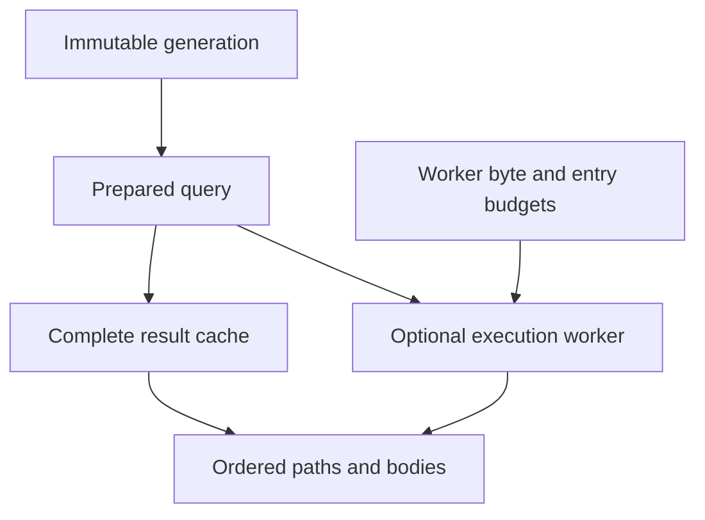

# Suffice 0.12 — Research and architecture dossier

This dossier combines the full engineering architecture and two primary-source research notes for New Runtime Tech. The executable 0.12 release implements independent retained-Worker limits and complete-result Capture. Its Release, sanitizer and integration gates passed, and its completed experiment contains 112 processes and 5,440 exact output checks. Measured findings, uncertainty and release decisions belong to `REPORT.md`.

The two research notes were written against the preserved 0.11 baseline before implementation. Their future-tense recommendations record that research stage. Part I and `REPORT.md` identify the implemented subset. Dependency witnesses, cross-generation result reuse, a shared reservation scheduler, asynchronous cancellation, binary transport and learned admission remain proposed work.

The purpose of the mathematical models is to state assumptions, expose counterexamples and define experiments. They are not machine-checked proofs of the current native implementation. Sixteen primary source entries are cataloged in `research/cache_sources.json` and `research/foundations_sources.json`; third-party papers are linked, not redistributed.

## Reading order

1. Integrated architecture: connect the computational, artifact and resource layers.
2. Cache economics: define the avoided work, remaining construction cost and full victim set before selecting policy.
3. Foundations: make dependency validity, shared ownership, cancellation and useful-output costs explicit.

---

## Part I — Integrated architecture

*Original release document: `docs/architecture_v0_12.md`.*

## Architecture after the complete-service experiment

### 1. The engineering target

New Runtime Tech began with two connected problems: expensive computation and uncontrolled resource growth when AI tools operate across many projects. Suffice's current executable foundation is narrower and testable: exact predicates over immutable artifact generations, selective payload decoding, explicit ownership, and persistent repository-tool service. The architectural objective is to make the cost of a useful operation follow the work and state that operation actually requires.

A useful operation includes its output contract. Reading complete file bodies, receiving identifiers, applying a delta, and consuming an aggregate are different operations. A faster identifier query cannot be counted as a faster full-file read unless the cost of resolving those identifiers is included. Likewise, a warm compiled kernel does not establish a faster session if capture, compilation, validation, transport and invalidation outweigh its savings.

The 0.12 implementation advances two foundations without changing the complete-body output contract: it separates worker retention from prepared-query retention, and it captures complete results during the normal decode/delivery traversal. The broader mechanisms below remain explicit research proposals. The current runtime is caller-serialized and is not a general incremental compiler, concurrent scheduler, OS, or replacement for Cargo.

### 2. Three independent decisions

Every proposed optimization must answer three questions in order.

| Decision | Required evidence | A mistake it prevents |
|---|---|---|
| Is the result valid? | Exact semantic identity and all relevant observations | Reusing output because a filename or row count happened to match |
| What representation should survive? | A reconstruction/consumption contract and complete ownership | Treating a mask, pointer or handle as though it contained complete output |
| Is retaining or building it worthwhile? | Future avoidable work, remaining construction cost, retention and victim costs | Maximizing hit count while making useful sessions slower |

Correctness must not depend on the quality of an economic predictor. If a reuse estimate is wrong, a design may perform unnecessary work or retain an unhelpful object. It must still return the same defined output and respect its resource contract.

For the current runtime, result identity remains the immutable generation owner, all predicate-source bytes, and requested global range. Complete caches also retain their exact prepared Query owner. The changes do not weaken those keys or allow an external selection mask to certify identity.

### 3. Split immutable knowledge from mutable execution state

In 0.11, a retained plan couples the prepared Query and its execution Worker. A Worker holds a decoder/context, masks, and prepared executors. Keeping a cheap reusable query therefore also keeps mutable execution capacity, even if subsequent calls replay complete cached results and never execute the worker.

In 0.12, a retained plan owns the Query independently and may own a Worker. Eviction can reset only the Worker. Later computation creates a new Worker from the same Query, preserving parse/compile work. Result replay does not touch worker recency because it does not use a worker.

The ownership arrows above show dependency, not independent copies. A cache and a plan may keep the same Query and Snapshot alive. Worker release does not falsely report that shared immutable storage has been reclaimed.

Let W be the workers attached to retained plans at a completed API boundary and b(w) their current reported component capacities. The implemented limits establish:

\[
|W|\le N_W,\qquad \sum_{w\in W}b(w)\le B_W.
\]

The proof obligation is about every settled exit, including exceptions. Constructor-time size alone is insufficient because decoder contexts can grow during execution. An allocation-free scope cleanup remeasures and trims before the call returns or unwinds. Individually oversized workers are transient; they do not displace fitting older workers. The remaining workers retain the newest fitting LRU prefix.

This is not a peak-RSS invariant. It excludes immutable query internals, active transient workers, candidate output buffers, consumers, allocator overhead and OS caches. Future claims of a hard controlled-memory ceiling require reserving capacity before the allocations occur, not merely trimming retained objects afterward.

### 4. Make result construction share the useful traversal

The preserved Recompute control performs a normal complete-output run, then one decode traversal to count cache storage and another to fill it. Exact decoded lengths already exist in the immutable snapshot. Counting them does not require decoding bodies again.

Capture uses this sequence:

1. Compute the exact selection against the immutable Query and range.
2. Enumerate that selection's decoded lengths and row count from the same snapshot metadata.
3. Check finite output limits before the first callback.
4. Privately allocate candidate row entries and body capacity if the result budget permits.
5. Decode each selected body once, deliver it to the sink, and copy it into the candidate after the callback returns.
6. Return the candidate only when every selected row has completed successfully.
7. Stage the catalog result-list node before evicting any existing cache entries.

Optional candidate allocation failure records a failure and continues normal output. An oversized candidate also permits uncached output. A sink or decode failure destroys the private candidate. Earlier external sink effects may remain under the existing streaming contract; private cache publication is transactional, external output is not.

Subtraction and division check candidate capacity without overflowing `rows * entry_size + bytes`. Actual vector capacity is checked after allocation as well. Empty selection can be a zero-byte result, but a selected empty body still consumes a row entry and row-output budget.

Capture removes two construction decode traversals by inspection of the implementation. The existing pipeline counters describe normal delivered output and omit Recompute's extra builder work. Therefore those counters alone must not be presented as measurements of total decoder traffic. Complete request/session time is the performance comparison; allocation/copy phase timers are diagnostic and include their own overhead.

The candidate exists alongside the normal worker and consumer. Although optional candidate allocation failure has a fallback, successful allocation can still increase transient pressure before later work. A whole-call reservation mechanism is a separate, stronger design.

### 5. Construction, retention and displacement have different economics

Suppose a direct request costs D, replay costs R, a candidate still needs C units of construction work, and H useful future reuses are expected before invalidation or eviction. Let O denote policy overhead and L(V) the future opportunity loss of all displaced victims V. A conditional preconstruction test is:

\[
H(D-R)\ge C+O+L(V).
\]

This is an explanatory decision model, not a proved online prediction algorithm. It assumes comparable units and a stated horizon. If replay is no cheaper than direct work, additional expected reuse cannot repay positive construction under the model.

Once construction is complete, C is sunk. Subtracting it again from a keep/evict decision makes that decision depend on an irreversible past cost. Conversely, building every candidate and rejecting it afterward cannot prevent wasteful construction. The runtime should eventually expose distinct preconstruction and postconstruction admission points.

Victim value must cover the whole victim set. A large candidate can displace multiple small entries; comparing it with only the last victim is insufficient. Shared storage makes reclamation even more subtle. If entries reference shared allocations, their standalone sizes cannot simply be added to predict bytes freed.

Worker value also has a different horizon from result value. A future request that hits a complete result avoids acquiring a worker. Worker retention is justified by future computed executions, including bypasses, result misses, new ranges or different queries. Counting all requests as worker reuse overestimates its utility.

These distinctions motivated the immediate implementation. A learned per-request controller is premature until the objective includes useful-service cost and all controlled retention pools. The research catalog covers GreedyDual-Size, aggregated-victim TinyLFU, S3-FIFO, SIEVE, LHD, CacheSack, Baleen and the July 2026 Learning-Augmented Heuristics work. Their external performance numbers are not Suffice results. See `../research/cache_economics.md` and its source catalog for primary references and adversarial cases.

### 6. Generalize validity before generalizing reuse

Whole-generation identity is deliberately conservative. Reusing across generations requires a complete dependency contract. The proposed model records deterministic observations made by a task: content reads, absent paths, directory membership, extractor/compiler versions, options, relevant environment values and dependency results.

For a deterministic task with all observations mediated by that interface, equal answers to the complete prior observation trace preserve the execution and output. The proof sketch is an induction on execution steps: equal initial state and prior answers produce the same next internal state and observation; equal observation answers maintain equality until termination. This relies on literal semantic equality or an explicitly accepted digest-collision assumption, not a magic property of a cache key.

Several counterexamples define the required scope:

- An absent configuration file becomes present. No previously read file changed, but behavior can change.
- A directory gains a matching source file. Cached glob/listing results become stale.
- An inserted path shifts generation-local row IDs. Unchanged body blobs may remain reusable, while an old row/path/body result does not.
- Compiler flags, locale, include paths, extractor versions or toolchain inputs change. Content identity alone is insufficient.
- Capture combines files from different logical moments. Reuse cannot repair an incoherent source snapshot.

A trace-budget exhaustion must return unknown and cause safe recomputation or explicit rejection. It must not silently classify an incomplete witness as valid. No dependency-witness engine or cross-generation result reuse is implemented in 0.12.

### 7. The broader resource model

For a fixed graph of immutable allocations, define the retained cost of root set S as:

\[
C(S)=\sum_{u\in\operatorname{closure}(S)}b(u).
\]

The marginal cost of adding a root decreases when more of its reachable allocations are already retained. The bytes actually reclaimed by removing victim set V are:

\[
C(S)-C(S\setminus V).
\]

External owners belong in S. This prevents reporting storage as freed while an old lease or alias still owns it. The proof and its fixed-graph assumptions are developed in `../research/foundations.md`; it is not a claim that the current runtime measures every process allocation through this formula.

A future scheduler needs the stronger controlled-allocation invariant:

\[
\text{live controlled bytes}+\text{outstanding reservations}\le B.
\]

All relevant allocation paths must participate, reservations must upper-bound actual demand, and ownership transfer must preserve charges. Cancellation cannot release charges until the underlying work has actually completed. For Windows, `CancelIoEx` requests cancellation and does not wait for completion; associated operation state must remain valid until completion is known. The primary Microsoft documentation is cataloged in the foundations sources. The present synchronous service does not implement this asynchronous scheduler.

### 8. Performance ambition with a falsifiable target

If an unchanged stage occupies fraction f of baseline elapsed time, removing every other stage gives an ideal additive-model ceiling of 1/f. If full-body delivery occupies more than one tenth of a session, compute-only improvement cannot yield a tenfold session improvement under that model. The fraction must be measured, not assumed from the current timing labels.

Three next experiments follow from this constraint:

| Experiment | Controlled comparison | Evidence needed before promotion |
|---|---|---|
| Binary framing for complete outputs | JSON/hex versus binary, same ordered paths and bodies | Complete downstream byte equivalence, cold and warm session latency, transport and allocation costs |
| Incremental validity | Whole-generation recompute versus complete observation witnesses | Edits, insertions, deletions, absent-to-present inputs, changed toolchains and fresh-oracle equality |
| Ten-project resource scheduling | Serialized service versus bounded shared execution | Duplicate demands, old leases, slow consumers, cancellation completion, reservation and ownership invariants |

Handles and deltas should be evaluated separately because their contracts differ. Include handle resolution or delta application in useful cost. Learned admission and lazy worker backends are also separate proposals, with overhead and failure behavior included in their comparisons.

The current 0.12 experiment is deliberately narrower: same binary and corpus, Capture versus Recompute, and generous versus tight worker retention. This can establish a concrete local tradeoff without confusing it with a new universal compiler result. Native Windows evidence on the target laptop remains required before making Windows latency, resident-memory or disk-footprint claims.

### Primary research and implementation evidence

- `../research/cache_sources.json`: eight primary cache/economics references with publication dates and application boundaries.
- `../research/foundations_sources.json`: eight primary incremental-computation, build-validity and platform sources.
- `worker_retention_v0_12.md`: implemented API and ownership contract.
- `../research/capture_review.md`: independent AI-assisted source review with exact inspected hashes.
- `retention_experiment_v0_12.md`: fixed comparison protocol and analysis boundaries.
- `../results/retention_v0_12/`: completed 112-process experiment and retained-record audit, both passed; `../REPORT.md` gives the measured results and their limits.

---

## Part II — Cache economics and policy research

*Original release document: `research/cache_economics.md`.*

## Retained computation as a constrained resource

### Research decision for the next Suffice runtime

Prepared November 11, 2026, America/Chicago; sources retrieved November 12 UTC. This note reviews the frozen Suffice 0.11 runtime and proposes a subsequent design. It does not claim that its proposed mechanisms have been implemented, benchmarked, or proved correct. Any 0.12 implementation must identify its actual subset and supply separate evidence. The existing competition manuscript remains a report of the earlier measurements.

**Recommended first change:** place retained prepared workers under an explicit byte budget. Complete-result admission and worker retention are different decisions, and they should have different accounting. Then reduce avoidable construction work and compare a bounded, inexpensive admission baseline before introducing a learned controller. A sophisticated score cannot compensate for charging the wrong resources or optimizing the wrong endpoint.

This recommendation follows the local evidence: the measured sessions retained 1,693,703 worker-component bytes versus 444,574 logical snapshot-input bytes; complete-result population did not consistently help the reuse trace and increased paired geometric service time under pressure. Those are findings for one preserved corpus and two traces, not evidence that caching is generally unhelpful. Sources: `suffice_v0_11/docs/catalog_api_v0_11.md`, `docs/catalog_review_v0_11.md`, and the preserved `Suffice_Kaggle_Writeup.md`; exact input identities appear in `cache_sources.json`.

### 1. What the literature changes about the design

The following are primary publisher, author, or institutional sources. Dates are the verified proceedings dates unless explicitly identified as an article publication date. The source catalog distinguishes those date types. External performance figures are deliberately omitted: they are not Suffice measurements.

| ID | Research and date | Mechanism to learn from | Boundary when applying it here |
|---|---|---|---|
| R1 | [Cao and Irani, Cost-Aware WWW Proxy Caching Algorithms](https://www.usenix.org/conference/usits-97/cost-aware-www-proxy-caching-algorithms), December 8–11, 1997 | GreedyDual-Size combines locality, retrieval cost, and object size. | A cheap hit does not repay a separately incurred materialization cost automatically. Define the actual avoided cost first. |
| R2 | [Einziger et al., Lightweight Robust Size Aware Cache Management](https://cris.technion.ac.il/en/publications/lightweight-robust-size-aware-cache-management/), published August 25, 2022; [author preprint](https://arxiv.org/html/2105.08770v2) | The Aggregated Victims variant compares a candidate with the combined frequency of all entries displaced to make room. | Comparing only the first victim can approve a harmful large admission. Construction costs and dependency sharing require additional analysis. |
| R3 | [Yang et al., FIFO Queues are All You Need for Cache Eviction](https://www.cs.cmu.edu/~rvinayak/papers/s3-fifo-sosp-2023-fifo-queues-are-all-you-need-for-cache-eviction.pdf), October 23–26, 2023 | S3-FIFO uses a small probationary queue, a main queue, and bounded ghost history to remove objects with little reuse. | Its resident probationary objects and a metadata-only second-touch gate have different first/second-access behavior. A new baseline must be named accurately. |
| R4 | [Zhang et al., SIEVE is Simpler than LRU](https://www.usenix.org/conference/nsdi24/presentation/zhang-yazhuo), April 16–18, 2024 | SIEVE combines lazy promotion with quick demotion using a queue, a hand, and visited state. | Its web-cache results do not establish a win for a small, caller-serialized catalog. Policy overhead must be measured at this scale. |
| R5 | [Beckmann et al., LHD: Improving Cache Hit Rate by Maximizing Hit Density](https://www.usenix.org/conference/nsdi18/presentation/beckmann), April 9–11, 2018 | Conditional reuse estimates rank expected hit contribution relative to occupied space. | Predicted hits are only a surrogate when different hits avoid different amounts of work. |
| R6 | [Yang et al., CacheSack](https://www.usenix.org/conference/atc22/presentation/yang-tzu-wei), July 11–13, 2022 | CacheSack chooses admission policies by workload categories using a knapsack formulation and deployment cost metrics. | A local runtime needs its own categories and measured costs; Google's flash-cache objective is not a laptop-runtime objective. |
| R7 | [Wong et al., Baleen](https://www.usenix.org/conference/fast24/presentation/wong), February 27–29, 2024 | Cache-residency episodes and an end-to-end backend-load metric guide admission and prefetching under a write-rate constraint. | This motivates measuring residency-limited useful work, not importing an ML model or flash-wear metric into Suffice. |
| R8 | [Xia et al., Learning-Augmented Heuristics](https://www.usenix.org/conference/osdi26/presentation/xia), July 13–15, 2026 | LAH separates a simple deterministic data path from occasional cache-level parameter learning; S4-FIFO is its evaluated instance. | Its learned objective is miss-ratio improvement. A Suffice controller must target whole-service cost and resource limits, and its training/overhead would need separate validation. |

R8 is a current 2026 research direction, not evidence that learning is the next implementation priority. The strongest common lesson is to make the expensive path simple, define the objective correctly, and account for the cost of the policy itself.

### 2. Separate four kinds of retained state

The current plan cache retains a compiled query and mutable worker together. A complete-result hit can replay output without preparing or decoding through that worker. Consequently, counting every repeated query as evidence for keeping its worker overvalues workers whose requests are already served by result hits.

The useful conceptual decomposition is:

| State | Why it exists | Relevant future event | Appropriate invalidation |
|---|---|---|---|
| Immutable generation | Establishes exact source/version meaning | Any valid read through an owner | Released only when all relevant owners expire |
| Compiled query | Avoids repeating source analysis/lowering | A computed execution of the same query and generation | Project retirement or explicit plan eviction |
| Mutable worker | Reuses prepared execution/decoder storage | A computed execution needing that worker | Independent byte/count pressure; release must not invalidate a cached result |
| Complete result | Avoids recomputation/decompression | A matching generation/source/range result lookup | Generation retirement, result pressure, or explicit clearing |

This is a design separation, not an assertion that all these allocations can already be detached cheaply. The implementation must inspect Query/Worker ownership before splitting objects. A bounded combined plan-and-worker cache is a valid smaller first step; it sacrifices some compilation reuse while making retention controllable.

Correctness identity and economic history have different requirements. A returned result must still match an exact key. Approximate frequency history may use bounded fingerprints because a collision would affect only an admission decision, provided it never authorizes replay or substitutes for exact key equality.

### 3. Derive the objective before choosing an algorithm

#### 3.1 Primary measured objective

For a fixed request sequence and byte-identical outputs, minimize complete service time subject to declared retention limits:

$$
\min_\pi T_{\mathrm{service}}(\pi)
\quad\text{subject to}\quad
W_\pi(t)\le B_W,\quad R_\pi(t)\le B_R,\quad H_\pi(t)\le B_H.
$$

Here W, R, and H denote the declared worker-component, result-capacity, and policy-history pools. The implementation must define whether the inequalities hold continuously or at settled operation boundaries. Peak RSS and transient allocation are separate measurements. Report the service-time/retention trade-off across capacities rather than inventing one universal conversion between a byte and a millisecond.

#### 3.2 Build and retain are two different decisions

Let D be the cost of computing and delivering a particular result without a retained complete result, R its cost when replayed to the same kind of consumer, and C the additional construction work still required. Let H be the number of useful future hits before eviction or invalidation. With fixed costs, creating the result is worthwhile only if

$$
H(D-R)\ge C+O+L(V),
$$

where O is incremental policy cost and L(V) is the lost future benefit of the complete victim set V. This is a conditional decision model, not a measured estimator or a guarantee. H and L(V) are unknown online and depend on the policy's own future decisions.

If there is no contention, no invalidation, and no incremental policy overhead, Populate-on-first-use has total cost

$$
D+C+(K-1)R,
$$

so for D>R its break-even request count is

$$
K\ge 1+\left\lceil\frac{C}{D-R}\right\rceil.
$$

An illustrative case with C=4 ms and D-R=0.2 ms requires at least 21 total requests. These numbers are a worked example, not a Suffice measurement. If D≤R, no finite number of identical repetitions repays a strictly positive C under this model.

**After construction has already completed, C is sunk.** The keep-versus-discard comparison must use future benefits and opportunity costs, not subtract the same completed build cost again. At that moment, even a candidate that should never have been built can still be worth keeping if free space exists and future replay helps. Conversely, discarding it cannot recover construction time. This distinction rules out the superficially attractive but incorrect policy of building every candidate and then claiming a post-build score prevented unprofitable construction.

#### 3.3 Worker value is conditional on result misses

Let P_i be the preparation work avoided by retaining worker i. Its expected future benefit is approximately

$$
V_i^W=\sum_{t>now}\Pr(\text{request needs computed execution }i\text{ at }t)\,P_{i,t}.
$$

The event includes a result-cache miss or bypass, current-generation eligibility, and continued worker residency. It is not simply the probability that query i is requested. Holding both a complete result and its worker can be reasonable for other ranges or explicit bypasses, but the two benefits cannot be counted independently for the same result hit.

The total retained allocation is likewise not the sum of arbitrary ownership-category statistics. If two structures share an allocation, reclaiming one owner may free no bytes. A future unified allocator must track an allocation-owner graph or another explicit deduplication model. Until then, preserve separate named pools and avoid an invented “total memory” sum.

#### 3.4 Delivery creates a ceiling on compute-only improvements

If a fraction f of baseline time is unavoidable output delivery and unchanged work, eliminating all other work yields a conditional speedup ceiling of 1/f. The current study's 99.65% selected plaintext fraction is a byte-selectivity measure; it does **not** establish f. Measure the timing fraction separately. Similarly, a JSON/hex transport represents B payload bytes with 2B hex characters before framing, but reducing those characters does not by itself establish a proportional wall-time gain.

### 4. Small implementation with strong invariants

#### 4.1 A worker-byte cap is a meaningful first increment

Add a separately configured retained-worker-component limit and expose the actual charge. A minimal implementation can continue evicting combined plan/worker entries by LRU until the byte limit, plan count, and source-text limit all fit. An oversized worker may execute transiently and then be released; it must not displace every useful entry merely to fail retention. Later splitting compiled plans from workers can preserve more compilation reuse.

Enforce the contract after worker construction **and after execution**, including exception paths: a worker may grow lazily when it encounters a larger body. A constructor-only check does not bound retained post-run capacities. A cleanup guard must not allocate or throw. If a cached worker cannot remain within the settled-state budget, detach it safely while preserving the active execution owner until the call ends.

Useful telemetry distinguishes `worker_prepared`, `worker_reused`, `worker_retained`, `worker_oversized`, and budget-triggered evictions. A legacy `plan_reused` bit alone becomes ambiguous if query compilation and worker preparation are separated. The exact field names are design proposals, not existing API promises.

#### 4.2 Result construction should reuse completed work when safe

The 0.11 Populate path performs a successful ordinary execution followed by two extra construction passes. A future capture-during-output path can stage an exact complete result while the initial execution already has the bytes. It must retain the output limits, exact ordering, range identity, and transactional admission behavior.

The difficult part is failure semantics. A consumer exception still propagates and prevents publication of a newly partial result. Optional capture allocation failure should disable capture and let the already requested ordinary output continue, where the API's contract permits that. No victim is removed until the candidate is complete and the commit requires no further allocating preparation. Report copied bytes, allocation behavior, and entire service time; “one pass” alone is not a performance result.

#### 4.3 A transparent admission baseline before learned policy

Introduce any adaptive mode separately so Bypass, Use, and Populate keep their current meanings. A useful first comparator is a bounded second-touch gate:

1. Keep a fixed-capacity, aged history of eligible completed requests.
2. On a first observed exact-key identity, compute without building a complete result.
3. On a later observation still represented in history, allow the normal bounded construction path.
4. Build the candidate privately; gather the full set of would-be victims before admission.
5. When using estimated benefit, compare the candidate with aggregate victim benefit; reject without destroying existing entries if the comparison fails.

This is a proposed baseline, **not an implementation of S3-FIFO or TinyLFU**. It deliberately makes second accesses miss when the first did not materialize a result. A two-access-only workload can make it strictly worse than immediate population; the test matrix must expose that case. History must have its own byte/count bound. Storing every 64 KiB source string in an unbounded history would recreate the original resource problem.

### 5. Correctness and accounting obligations

The next change should preserve or explicitly strengthen these invariants:

1. **Exact output:** policy changes never alter returned row IDs, paths, order, or complete bodies.
2. **Exact generation:** history and caches cannot authorize old bytes for a new generation.
3. **Retired owners:** executing a retired lease creates no new persistent owner chain.
4. **Hit independence:** result hits can succeed without retaining or recreating a mutable worker.
5. **Settled worker bound:** retained component charges fit the configured worker cap on every completed or exceptional API exit covered by the contract.
6. **Actual capacities:** accounting uses retained capacities/owned components, not only requested lengths.
7. **Candidate isolation:** optional construction or node-allocation failure preserves existing retained entries until commit.
8. **Consumer semantics:** consumer failures propagate; partial new candidates never become hits.
9. **No early victim loss:** victim selection is planning; removal occurs only after candidate completion and all fallible commit preparation.
10. **Bounded control state:** history, ghost entries, counters, and statistics cannot grow with an unbounded stream of distinct sources.
11. **Checked arithmetic:** capacity sums, counters, size estimates, and epoch arithmetic reject or saturate rather than wrap.
12. **Honest boundary:** component limits do not imply RSS, decoder-library allocation, external-consumer, or peak-construction limits.

A budget test should exercise the behavior that threatens the invariant, not merely assert that the implementation's counter equals itself. For example, independently sum known retained capacities, force lazy growth, and check the observable release/reprepare behavior after both success and callback failure.

### 6. Adversarial workload matrix

| Workload | Why a plausible policy fails | Required observation |
|---|---|---|
| Hot pair, long one-touch scan, hot pair | LRU scan pollution; unconditional construction pays for objects never reused | Full service cost, build count, retained hot entries, exact output |
| Every item accessed exactly twice | Second-touch construction occurs after the last useful access | Additional build work and absence of later hits remain visible |
| Cyclic working set slightly larger than capacity | LRU and simple probation can thrash continuously | Repreparations, admissions/evictions, capacity sweep |
| Sudden hot-set replacement | Lifetime frequency locks in yesterday's hot objects | Adaptation interval and new hot-set service cost |
| One large candidate displaces several small valuable entries | First-victim comparison ignores aggregate opportunity loss | Victim set and combined reclaimed capacities/benefits |
| Popular but cheap computation, rare expensive computation | Frequency alone values the wrong avoided work | Per-class service and construction cost |
| Empty results and tiny payloads | Payload-byte cap permits unbounded metadata/count growth | Entry count, key/history size, source-length limits |
| Frequent project updates with identical shapes | Dimension/source similarity permits stale reuse if identity is weakened | Byte comparison through old/new leases and history reset semantics |
| Complete-result hits after clearing all workers | Worker retention is incorrectly required for hits | Zero new worker preparation on successful result hits |
| A large body encountered after earlier small queries | Scratch grows after the initial budget check | Post-run and exceptional-exit retained charge |
| Slow or throwing consumers | Internal compute timing is mistaken for useful-service time; partial candidate leaks | Complete session timing and exception/cleanup behavior |
| Long source strings and unique query spam | Admission metadata exceeds the cache it was meant to protect | Fixed history bound and lookup/hash overhead |
| External snapshot aliases and retired leases | Removing a catalog entry is mistaken for physical reclamation | Live-owner charge until the last owner is actually released |
| Allocation failure while staging candidate or victim bookkeeping | Existing entries are evicted before the operation can commit | Prior hits and exact outputs remain available |

No single successful trace establishes robustness across this matrix. Each new retained-state mechanism should satisfy its relevant correctness cases; performance comparisons can then use a small, explicitly chosen subset.

### 7. Experiment design that can reject the idea

Freeze source identities and use the same original-byte oracle for the baseline and candidate. Preserve the 0.11 historical result instead of relabeling it. Compare, at minimum, the old policy, the new worker budget with result bypass, and the new budget with the existing Populate/Use behavior. If admission changes, add it as a separate arm so a construction optimization cannot be confused with a retention-policy gain.

Use identical inputs, output consumer, request traces, and process-lifetime boundaries. Alternate paired order. Report raw session wall time, explicit oracle time, service time, preparation/construction time, complete output bytes, and policy bookkeeping. State CPU affinity, filesystem-cache treatment, compiler/codec versions, and whether the CPU is shared. A profiler-only compute benchmark can explain a result, but it cannot replace the service experiment.

Sweep worker capacity around actual working-set boundaries, including zero retained workers, one-worker capacity, a hot-subset capacity, and enough for all measured workers. Report retained peak/terminal components and preparation counts together. A lower retained footprint with worse latency is a trade-off, not automatically an improvement. Worker budgeting can be useful even when no speedup occurs because it changes enforceable resource behavior.

For performance, requests within one process are correlated; process pairs remain the independent reporting unit under the chosen experiment. Use observed ranges and pair direction counts when the run count is small. Do not convert a small sample into a universal confidence claim. Include failure traces separately from timed runs so fault injection does not contaminate normal-performance comparisons.

### 8. Direction beyond this increment

The larger system can eventually treat immutable source generations, reusable compilation, mutable execution scratch, complete outputs, and on-disk artifacts as a graph of owned resources with different useful lifetimes. Its controller should choose materialization and retention under explicit budgets while correctness remains independent of prediction quality.

A reasonable subsequent sequence is: measure marginal saved work; introduce bounded cohort statistics; explore aggregate-victim admission; then compare periodic configuration changes against fixed baselines. LAH suggests how the control path could remain outside ordinary requests, while CacheSack and Baleen motivate choosing the actual system objective. None supplies a ready-made proof or model for this runtime. Before learning, record counterfactual uncertainty: a retained hit does not reveal how expensive a miss would have been at that same moment.

The highest-value near-term result is therefore a smaller, bounded retained footprint with preserved semantics and transparent latency cost. A later speedup claim needs a measured mechanism—less decoding, less copying, fewer preparations, or less transport—rather than a more elaborate policy name.

---

## Part III — Incremental validity, ownership and scheduling

*Original release document: `research/foundations.md`.*

## Toward a bounded, demand-driven developer-tool runtime

Research date: 2026-11-11, America/Chicago. Baseline inspected: Suffice 0.11.0 and the preserved 0.9/0.10 architectural work. This is a design extension with explicit proof obligations and experiments. It does not claim that the proposed dependency graph, asynchronous scheduler, content handles, or incremental capture are implemented in 0.12. The release implementation and its new measurements must be reported separately.

### 1. What the project should become

The strongest larger direction is a runtime that decides **which exact information and execution state are worth keeping for the computations a developer actually demands**. It should coordinate ten projects as one resource-constrained workload while preserving each project's version and output contracts.

The earlier work already separates semantic sufficiency from physical speed, provides bounded continuation-encoding checks, and demonstrates an exact gate-to-payload boundary. Version 0.11 adds immutable generations, publication revisions, leases, capture, and a persistent service. The next architectural contribution is to connect these pieces without allowing a policy decision to weaken correctness.

That requires three independent questions for every reusable object:

1. **Validity:** Is this still an exact answer to this observation under these dependencies?
2. **Representation:** In what form can that answer be retained or reconstructed?
3. **Economics:** Is retaining that representation better than rebuilding it under the current demand and resource constraints?

Answering the third question cannot establish the first. A hot result may be stale; a cold result may be valid; a compressed representation may be exact yet more expensive to use. The architecture should make these distinctions mechanically visible.

The relevant research precedent is substantial. Adapton separates changes from demanded recomputation; Nominal Adapton makes reusable computation names explicit; self-adjusting computation studies equivalence with execution from scratch. These are precedents and correctness targets, not evidence that Suffice already inherits their proofs or performance. [F01–F03]

### 2. A layered identity model

One cache key should not stand in for all kinds of identity. Introduce the following conceptual records; the exact serialization is future API work.

| Record | Meaning | Must not be confused with |
|---|---|---|
| `BlobIdentity` | Exact byte-string identity, with length and algorithm/version domain | Filename, file ID, row number, or semantic meaning |
| `ManifestIdentity` | Ordered path-to-blob mapping and extraction/schema contract for one captured version | A coherent application commit unless capture establishes one |
| `TaskIdentity` | Operator implementation/version, declared parameters, dependency-resolution rules, and observable output contract | A particular native executor or its current performance |
| `DependencyWitness` | The observations made during one successful deterministic evaluation | Merely the positive file reads that happened to be logged |
| `RepresentationIdentity` | Encoding, physical layout, ABI/ISA requirements, and reconstruction contract | The computation's logical answer |
| `DemandLease` | A consumer's interest in a particular version/answer and retained owners | Permission to change that answer when a newer version appears |

Domain-separated hashes are useful compact indexes. For exact byte identity, either compare candidate bytes on a hash match or explicitly state the cryptographic collision-resistance assumption. A finite digest is not an injective mathematical encoding of arbitrary byte strings. The current SHA-256 checks are practical integrity checks; they do not prove semantic equivalence of distinct programs.

Stable names help recover sharing across executions, but a name is not permission to ignore a changed computation. Nominal Adapton provides a relevant semantic treatment of names and reuse. For Suffice, keep the stable lookup name separate from the implementation/environment identity that validates the located object. [F03]

#### An important relocation counterexample

Suppose an unchanged file has row 8 in generation A. Inserting a lexically earlier path makes it row 9 in generation B. Its body can share a blob, and a per-blob pure feature can share a value. The previous `(row 8, path, body)` response cannot be replayed as a complete generation-B answer. Reuse must occur beneath the generation-local ordering boundary, followed by reconstruction of the new row/path sequence.

This suggests a useful first cross-generation optimization: share immutable body/feature values by exact content and extractor identity, while reconstructing generation metadata. Do not begin by transplanting old row masks or complete results across generations.

### 3. Dependency validity as an executable obligation

Build Systems à la Carte separates scheduling from rebuilding and discusses untracked inputs, volatile tasks, and nondeterminism. Its model makes a key requirement explicit: reuse depends on the actual task dependencies, including the rule/tool context. [F04] Build environments can also include tool versions, target platform, locale, paths, and selected environment variables; the dependency scope must be declared for the task rather than inferred from a source digest. [F07]

For a future deterministic task, expose observations through a versioned interface:

- `read_bytes(path)` returns an immutable content identity or a typed failure.
- `exists(path)` returns a versioned presence/absence value.
- `list_directory(path, policy)` returns a canonical membership observation.
- `read_config(key)` and `read_environment(key)` return explicit versioned values.
- `invoke_tool(tool_identity, arguments, inputs)` identifies all allowed external effects.

Untracked clock, network, random, filesystem, or process observations make the task volatile unless their values are explicitly captured as inputs. A tool whose dependency access cannot be intercepted or declared does not yet qualify for exact incremental reuse.

#### Claim 1: equality of complete observations preserves deterministic output

Let an evaluation be deterministic except for calls to the observation interface. Assume its code, parameters, environment semantics, and initial internal state are fixed. Let its recorded sequence be `[(q1,a1), ..., (qn,an)]`. If replay against one immutable new world returns the same answer `ai` for every observation `qi` reached in the sequence, the task produces the same output and performs the same sequence of observations.

**Proof sketch:** before the first observation, deterministic execution is identical. Equal first answers imply identical state until the second observation. Induct on the observation number. A first control-flow divergence would require either different deterministic computation or a different earlier observation answer, contradicting the assumptions. The argument also covers dynamic dependencies: an unchanged controlling observation means the same next dependency is requested.

**Limits:** this is a theorem for the stated interface model, not a proof of a C++ implementation. The observations must be complete and resolved against one coherent immutable version. Digest equality is conditional on its identity contract. Undefined behavior, uncontrolled effects, and nontermination require separate handling.

#### Counterexamples that define the boundary

1. **Absent configuration:** a task defaults to mode A because `config.json` is absent. A new file changes the answer although every previously read file has unchanged bytes. Recording only positive reads is unsound.
2. **Directory enumeration:** `*.cpp` gains one file. Rechecking old file digests does not validate the old file list.
3. **Extractor change:** the bytes are unchanged but an extension dictionary changes. Old feature values are not valid under the new extractor.
4. **Mixed capture:** task observations are individually valid but drawn from different application revisions. Their conjunction need not describe any actual committed state.
5. **Hidden compiler context:** a compiler binary, flags, target, or environment changes. Source identity alone does not validate old output.

The initial implementation should reject dependency cycles with a concrete cycle witness. Supporting cycles requires a separate semantic choice—such as a monotone fixed point with a convergence contract—not merely removing the cycle check.

#### Early cutoff and trace budgets

After an input changes, reevaluate only demanded descendants. If a node's canonical observed value is unchanged, consumers depending only on that value need not be recomputed. This is a value-equality argument, not a universal property of equal file sizes or equal hashes of partial metadata.

The dependency graph itself consumes memory. Bound node count, edge count, key bytes, trace bytes, and retained observations. If a trace exceeds its budget, finish the task under a nonmemoized execution mode and discard its incomplete reuse record; do not store an incomplete trace as valid. Adapton supplies the demand-driven precedent. Salsa provides current practical examples of query eviction, dependency-based validation shortcuts, and cancellation, but its policies and Rust invariants cannot simply be imported into Suffice's C++ ownership model. [F01, F05, F06]

### 4. Representations form a graph, not a single cache tier

For one observation, candidate retained states might include:

- Immutable compressed bodies plus coarse reusable summaries.
- A prepared query with no retained worker scratch.
- An exact selected-row set tied to a manifest and query.
- Complete decoded output for that observation.
- A checked generated execution kernel.

Each representation needs a reconstruction edge with a precondition, output identity, cost, and temporary-resource bound. These candidates are not totally ordered. A prepared kernel may accelerate many future queries but not preserve a particular result; a row set can avoid predicates but still requires decoding; full output can avoid decoding while retaining far more bytes.

Do not use one opaque quality score to combine latency, memory, storage, and energy. A practical controller can minimize measured useful-session latency subject to explicit resource constraints, then report other costs separately. If the user supplies priorities, weighted objectives become meaningful, but the units and weights must remain visible.

#### Claim 2: delivery is a lower bound under an unchanged body-output contract

For a consumer that must receive B arbitrary bytes through a channel of effective rate beta, delivery requires at least approximately `B / beta` time in the bandwidth-limited model, apart from protocol and synchronization. A predicate optimization does not remove those bytes. More generally, if an unmodified common stage consumes fraction f of a baseline session, eliminating all other work gives an ideal speedup no greater than `1 / f` under the additive model.

**Consequence:** a 10× end-to-end target requires reducing every unchanged stage whose combined fraction exceeds 10%, or changing what the consumer actually needs. These are planning bounds, not a measured percentage breakdown of 0.11.

The current protocol transports bodies as hexadecimal in JSON. Encoding B body bytes as hex requires 2B payload characters before the surrounding syntax. A binary framed transport may reduce that representation overhead while returning the same bytes, but it still must be measured end to end. It is not automatically a twofold service speedup.

Content handles, aggregates, and deltas are stronger possibilities only when the consumer accepts their contracts:

| Contract | Exactness obligation |
|---|---|
| Full bodies | Deliver the complete ordered row/path/body sequence |
| Content handles | Retain or resolve the identified immutable bodies for the lease lifetime |
| Aggregate | Return the exact declared aggregate; callers cannot infer omitted bodies |
| Delta | Name the required base manifest, ordered patch operations, and final identity |

A delta against the wrong base must fail. A handle is not a byte transfer until its downstream fetch is charged. Calling either one equivalent to full-body service without counting consumption would create a false improvement.

### 5. Shared ownership makes memory accounting a set problem

Let U be the set of separately owned allocations, with charged sizes `b(u) >= 0`. For roots S, let `closure(S)` be all allocations kept live by those roots. Then the logical retained footprint is

`C(S) = sum(b(u) for u in closure(S))`.

This is not generally the sum of object-local sizes. If A and B both retain a 1 MiB snapshot and have 1 KiB private metadata each, evicting A reclaims only its 1 KiB while B remains. Evicting both can release the shared MiB. A fixed per-entry charge of either 1 MiB or 0.5 MiB misstates one of these transitions.

#### Claim 3: retained-allocation cost has diminishing marginal additions

For a fixed ownership graph with root sets `S subset T`, the additional allocations exposed by adding root x to S include those exposed by adding x to T. Thus `C(S union {x}) - C(S) >= C(T union {x}) - C(T)`. This follows directly from set union and nonnegative sizes.

The useful eviction quantity is instead `C(S) - C(S minus V)` for a proposed victim set V. It depends on the complete surviving ownership graph, including external leases. This derivation explains why static value-per-byte rankings can make poor decisions even with perfect value estimates. It does not prove that an online global optimum is cheaply attainable.

A tractable first controller should group accounting by actual shared owners, report private and shared charges separately, and recompute reclaimable bytes for each small candidate victim set. Keep policy history bounded. Evicting a logical entry that is externally pinned can remove its future discoverability without immediately freeing its storage; those are different events.

#### Claim 4: an admitted-memory bound needs reservations before work starts

For allocations controlled by a budgeted allocator, maintain

`live_controlled_bytes + outstanding_reservations <= B`.

Admit a job only after reserving a proven upper bound for its additional controlled allocations. During execution, atomically convert reservation bytes into live charges; releasing an allocation restores its charge. No transition increases the sum beyond B if reservation increases are checked first. The invariant follows by induction over these transitions.

The proof fails if an uncharged allocation path exists, an estimate is treated as a bound, or a reservation is released while another task can still access the memory. Unknown-size output must grow by checked chunks, spill under a separate disk budget, stream under backpressure, or stop explicitly.

Even a correct controlled-allocation invariant is not an RSS bound. Allocator fragmentation, stacks, libraries, mappings, OS pages, and consumer processes require separate measurement or control. Report retained controlled bytes, active work reservations, active controlled bytes, and process RSS separately.

There is also a hard semantic limitation: arbitrary independently pinned immutable histories cannot all remain exactly accessible in bounded memory without external storage, recomputation, refusing further leases, or limiting history. Worst-case incompressible data defeats a universal compression promise. The API must choose among those mechanisms rather than claiming that an eviction policy can eliminate the tradeoff.

### 6. Demand, cancellation, and publication must share one lifecycle

Adopt a proposed execution record with `task identity`, `world/version`, `demand count`, `reservation`, `cancellation state`, `private candidate`, and `completion state`.

1. A demand acquires an immutable version lease and either joins an identical in-flight computation or creates one after reserving resources.
2. The computation builds privately. It may stream output only under a declared partial-output contract; an incomplete stream is not a successful cached result.
3. At safe boundaries it checks cancellation and available output/trace budget.
4. Before reusable publication, it validates the dependency witness and checks the required revision policy.
5. A successfully published object receives the live charge; unused reservations are returned.
6. Failure or cancellation releases private state only after all users of it have completed.

Joining work needs exact semantic/version identity. Similar-looking queries are insufficient. One consumer releasing its demand does not cancel shared work while another consumer still requires it. A latest-version request can reject a stale candidate; a snapshot request can still finish validly against its pinned older generation. Keep these modes explicit.

#### Cancellation is a request, not reclamation

For a CPU loop, a cancellation check every bounded chunk only gives a useful latency bound if each chunk's cost is bounded. A large codec call, blocked callback, or arbitrary tool subprocess can invalidate the bound. The scheduler must distinguish cooperative checks, completed cancellation, timeout, and forced process termination.

On Windows, `CancelIoEx` marks outstanding operations for cancellation and does not wait for their completion. Associated `OVERLAPPED` storage cannot be freed or reused until completion is known. The operation can still finish normally. Therefore resource charges and owner lifetimes must follow completion, not the moment a cancellation request is issued. [F08]

A slow consumer needs a bounded queue and backpressure. Otherwise removing computation overhead merely moves unbounded memory growth into pending output. Useful admission controls include per-project concurrency limits, global reservation limits, and aging of queued demands. Priority and fairness should be evaluated under the ten-project use case rather than selected only for maximum single-job throughput.

### 7. Three experiments that can falsify this architecture

These are proposed follow-on experiments, not completed results. Each compares identical observations where claimed and retains cold, warm, changed, and adverse cases.

#### E1 — Incremental validity with bounded dependency witnesses

**Question:** can cross-generation reuse reduce changed-session work without missing negative or structural dependencies?

Build a small developer-tool adapter that derives an index from a versioned source manifest. Compare full recomputation, whole-generation reuse, and dependency-validated reuse. Use controlled changes: irrelevant body edit, relevant edit, new matching file, absent-to-present config, rename, extractor change, same-value edit, and dependency switching. Include a query reading most of the project as a likely negative case.

**Oracle:** recompute every demanded output from scratch against the same immutable manifest and compare complete canonical bytes. Deliberately omit each dependency class once in a fault-injected reference to prove the test detects that missing class.

**Metrics:** complete session time, witness-validation time, recomputed nodes, trace bytes, retained bytes, and cold-start overhead. Vary changed fraction and demanded fraction separately. Require zero stale outputs and the trace budget to hold. If validation costs more than recomputation for a workload, preserve that result and use the simpler path there.

#### E2 — Representation and downstream consumption

**Question:** is the next dominant improvement in computation, output representation, or consumer demand?

For exactly the same full-body output, compare the present JSON/hex protocol with a bounded binary frame protocol. Then run a separate contract experiment comparing full bodies, pinned handles, and base-checked deltas for a consumer that actually resolves or applies them. Vary selectivity, body entropy, body size, locality, repetitions, and consumer speed. Keep the exact predicate and decoded data fixed within each comparison.

**Oracle:** the final consumer-visible bytes and order must match after all handle resolution or delta application. Inject stale bases, expired leases, truncated frames, and cancellation. Never compare a handle-only producer timer with a full-body consumer timer.

**Metrics:** first usable answer, total producer-plus-consumer time, delivered wire bytes, decoded/copied bytes, allocation counts, retained/reserved bytes, and peak RSS. A binary transport improvement can be reported independently of a changed consumer contract. Reject an optimization that only shifts memory or work into an unmeasured consumer.

#### E3 — Ten-project ownership and cancellation pressure

**Question:** can shared work and bounded reservations improve useful progress under project switching, stale work, and slow consumers?

Use ten project namespaces, alternating active roots, duplicate demands, captured updates, large cold scans, retained old leases, and consumers with controlled read rates. Compare serialized execution, a fixed concurrency pool, and reservation-aware admission with exact in-flight deduplication. Initially use a small predetermined set of job memory bounds rather than a learned predictor.

**Oracle:** every completed demand returns the exact output for its stated version; canceled/partial demands never enter the successful cache. Assert the controlled allocation/reservation invariant at every state transition. Track owners through delayed I/O completion and inject failures before/after candidate publication.

**Metrics:** median and tail completion latency, oldest-demand waiting time, useful completed work, wasted work after cancellation, reservation occupancy, retained old-generation bytes, physical RSS, and disk writes. Run on the target native Windows laptop as a separate platform gate; Linux-only results cannot establish the requested Windows behavior.

The hypothesis fails if coordination overhead dominates, old pinned generations block useful admission indefinitely without a declared policy, resource bounds are exceeded, or an apparently canceled operation still accesses released storage.

### 8. Prioritized engineering sequence

First remove unnecessary retained worker state while keeping current exact outputs and serialized behavior. That is an immediately measurable change with a smaller proof surface than a new dependency runtime. Preserve preparation costs in the comparison.

Next introduce a bounded binary output route or a narrowly scoped incremental feature reuse experiment, choosing according to measured complete-session cost. Do not mix transport, dependency tracking, worker changes, and cache policy into one unexplained performance result.

Only after those measurements introduce the general demand graph and concurrent admission protocol. Its graph, queue, and metadata are themselves budgeted resources. The long-term compiler can then choose valid representations and execution tiers using actual costs, with bounded solvers returning unknown rather than silently accepting unproved rewrites.

The ambitious deliverable is an exact, measurable resource governor for developer computation: it controls what is retained, when work becomes worthwhile, how dependencies establish validity, and when obsolete work stops consuming the laptop. It does not require a new OS before these benefits can be tested.

### Sources

- **F01:** Matthew A. Hammer, Yit Phang Khoo, Michael Hicks, Jeffrey S. Foster. *Adapton: Composable, Demand-Driven Incremental Computation*. PLDI 2014. DOI: 10.1145/2594291.2594324. [Author-hosted accepted paper](https://www.cs.umd.edu/~mwh/papers/adapton-submit.pdf); [artifact](https://www.cs.umd.edu/projects/PL/adapton/). The linked accepted manuscript carries a 2013 draft date; the publication is PLDI 2014.
- **F02:** Umut A. Acar, Matthias Blume, Jacob Donham. *A Consistent Semantics of Self-Adjusting Computation*. ESOP 2007; full version submitted 2011-06-02. [arXiv:1106.0478](https://arxiv.org/abs/1106.0478).
- **F03:** Matthew A. Hammer et al. *Incremental Computation with Names*. OOPSLA 2015; arXiv v6 revised 2021-03-23. DOI: 10.1145/2814270.2814305. [arXiv:1503.07792v6](https://arxiv.org/abs/1503.07792v6).
- **F04:** Andrey Mokhov, Neil Mitchell, Simon Peyton Jones. *Build Systems à la Carte: Theory and Practice*. Journal of Functional Programming 30, e11, 2020. DOI: 10.1017/S0956796820000088. [Author manuscript](https://simon.peytonjones.org/assets/pdfs/build-systems-jfp.pdf).
- **F05:** Salsa project. [Tuning: cache eviction and cancellation](https://salsa-rs.github.io/salsa/tuning.html). Current documentation accessed 2026-11-12 UTC; no source publication date asserted.
- **F06:** Salsa project. [Durability](https://salsa-rs.github.io/salsa/reference/durability.html). Current documentation accessed 2026-11-12 UTC. Here durability concerns change frequency/validation shortcuts, not storage durability after power loss.
- **F07:** Reproducible Builds project. [What's in a build environment?](https://reproducible-builds.org/docs/perimeter/). Current primary project documentation accessed 2026-11-12 UTC.
- **F08:** Microsoft. [CancelIoEx function](https://learn.microsoft.com/en-us/windows/win32/api/ioapiset/nf-ioapiset-cancelioex). Current primary platform documentation accessed 2026-11-12 UTC.

Claims 1–4 are explicitly stated reasoning for the proposed interface and accounting models. They are not presented as novel mathematical results, as formal verification of Suffice, or as theorems inherited wholesale from the sources. No paper PDF is redistributed by this document.

