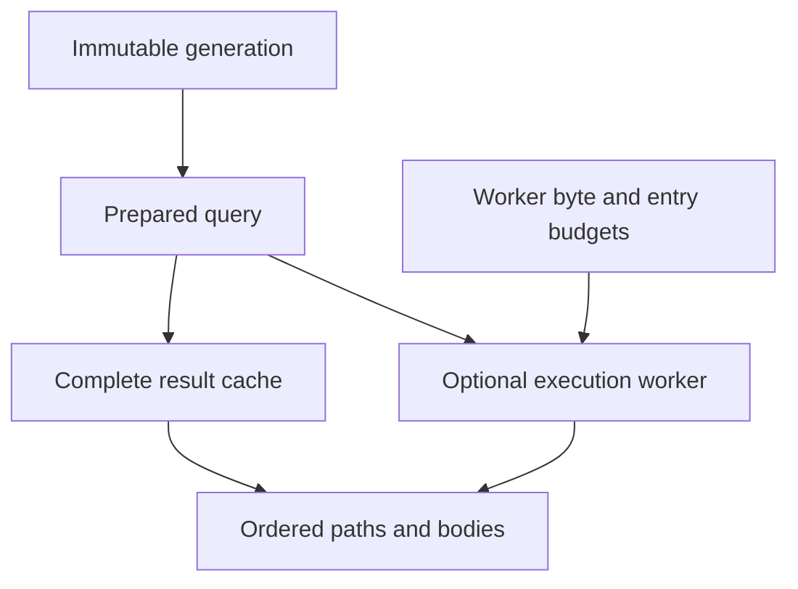

# Architecture after the complete-service experiment

## 1. The engineering target

New Runtime Tech began with two connected problems: expensive computation and uncontrolled resource growth when AI tools operate across many projects. Suffice's current executable foundation is narrower and testable: exact predicates over immutable artifact generations, selective payload decoding, explicit ownership, and persistent repository-tool service. The architectural objective is to make the cost of a useful operation follow the work and state that operation actually requires.

A useful operation includes its output contract. Reading complete file bodies, receiving identifiers, applying a delta, and consuming an aggregate are different operations. A faster identifier query cannot be counted as a faster full-file read unless the cost of resolving those identifiers is included. Likewise, a warm compiled kernel does not establish a faster session if capture, compilation, validation, transport and invalidation outweigh its savings.

The 0.12 implementation advances two foundations without changing the complete-body output contract: it separates worker retention from prepared-query retention, and it captures complete results during the normal decode/delivery traversal. The broader mechanisms below remain explicit research proposals. The current runtime is caller-serialized and is not a general incremental compiler, concurrent scheduler, OS, or replacement for Cargo.

## 2. Three independent decisions

Every proposed optimization must answer three questions in order.

| Decision | Required evidence | A mistake it prevents |
|---|---|---|
| Is the result valid? | Exact semantic identity and all relevant observations | Reusing output because a filename or row count happened to match |
| What representation should survive? | A reconstruction/consumption contract and complete ownership | Treating a mask, pointer or handle as though it contained complete output |
| Is retaining or building it worthwhile? | Future avoidable work, remaining construction cost, retention and victim costs | Maximizing hit count while making useful sessions slower |

Correctness must not depend on the quality of an economic predictor. If a reuse estimate is wrong, a design may perform unnecessary work or retain an unhelpful object. It must still return the same defined output and respect its resource contract.

For the current runtime, result identity remains the immutable generation owner, all predicate-source bytes, and requested global range. Complete caches also retain their exact prepared Query owner. The changes do not weaken those keys or allow an external selection mask to certify identity.

## 3. Split immutable knowledge from mutable execution state

In 0.11, a retained plan couples the prepared Query and its execution Worker. A Worker holds a decoder/context, masks, and prepared executors. Keeping a cheap reusable query therefore also keeps mutable execution capacity, even if subsequent calls replay complete cached results and never execute the worker.

In 0.12, a retained plan owns the Query independently and may own a Worker. Eviction can reset only the Worker. Later computation creates a new Worker from the same Query, preserving parse/compile work. Result replay does not touch worker recency because it does not use a worker.

The ownership arrows above show dependency, not independent copies. A cache and a plan may keep the same Query and Snapshot alive. Worker release does not falsely report that shared immutable storage has been reclaimed.

Let W be the workers attached to retained plans at a completed API boundary and b(w) their current reported component capacities. The implemented limits establish:

\[
|W|\le N_W,\qquad \sum_{w\in W}b(w)\le B_W.
\]

The proof obligation is about every settled exit, including exceptions. Constructor-time size alone is insufficient because decoder contexts can grow during execution. An allocation-free scope cleanup remeasures and trims before the call returns or unwinds. Individually oversized workers are transient; they do not displace fitting older workers. The remaining workers retain the newest fitting LRU prefix.

This is not a peak-RSS invariant. It excludes immutable query internals, active transient workers, candidate output buffers, consumers, allocator overhead and OS caches. Future claims of a hard controlled-memory ceiling require reserving capacity before the allocations occur, not merely trimming retained objects afterward.

## 4. Make result construction share the useful traversal

The preserved Recompute control performs a normal complete-output run, then one decode traversal to count cache storage and another to fill it. Exact decoded lengths already exist in the immutable snapshot. Counting them does not require decoding bodies again.

Capture uses this sequence:

1. Compute the exact selection against the immutable Query and range.
2. Enumerate that selection's decoded lengths and row count from the same snapshot metadata.
3. Check finite output limits before the first callback.
4. Privately allocate candidate row entries and body capacity if the result budget permits.
5. Decode each selected body once, deliver it to the sink, and copy it into the candidate after the callback returns.
6. Return the candidate only when every selected row has completed successfully.
7. Stage the catalog result-list node before evicting any existing cache entries.

Optional candidate allocation failure records a failure and continues normal output. An oversized candidate also permits uncached output. A sink or decode failure destroys the private candidate. Earlier external sink effects may remain under the existing streaming contract; private cache publication is transactional, external output is not.

Subtraction and division check candidate capacity without overflowing `rows * entry_size + bytes`. Actual vector capacity is checked after allocation as well. Empty selection can be a zero-byte result, but a selected empty body still consumes a row entry and row-output budget.

Capture removes two construction decode traversals by inspection of the implementation. The existing pipeline counters describe normal delivered output and omit Recompute's extra builder work. Therefore those counters alone must not be presented as measurements of total decoder traffic. Complete request/session time is the performance comparison; allocation/copy phase timers are diagnostic and include their own overhead.

The candidate exists alongside the normal worker and consumer. Although optional candidate allocation failure has a fallback, successful allocation can still increase transient pressure before later work. A whole-call reservation mechanism is a separate, stronger design.

## 5. Construction, retention and displacement have different economics

Suppose a direct request costs D, replay costs R, a candidate still needs C units of construction work, and H useful future reuses are expected before invalidation or eviction. Let O denote policy overhead and L(V) the future opportunity loss of all displaced victims V. A conditional preconstruction test is:

\[
H(D-R)\ge C+O+L(V).
\]

This is an explanatory decision model, not a proved online prediction algorithm. It assumes comparable units and a stated horizon. If replay is no cheaper than direct work, additional expected reuse cannot repay positive construction under the model.

Once construction is complete, C is sunk. Subtracting it again from a keep/evict decision makes that decision depend on an irreversible past cost. Conversely, building every candidate and rejecting it afterward cannot prevent wasteful construction. The runtime should eventually expose distinct preconstruction and postconstruction admission points.

Victim value must cover the whole victim set. A large candidate can displace multiple small entries; comparing it with only the last victim is insufficient. Shared storage makes reclamation even more subtle. If entries reference shared allocations, their standalone sizes cannot simply be added to predict bytes freed.

Worker value also has a different horizon from result value. A future request that hits a complete result avoids acquiring a worker. Worker retention is justified by future computed executions, including bypasses, result misses, new ranges or different queries. Counting all requests as worker reuse overestimates its utility.

These distinctions motivated the immediate implementation. A learned per-request controller is premature until the objective includes useful-service cost and all controlled retention pools. The research catalog covers GreedyDual-Size, aggregated-victim TinyLFU, S3-FIFO, SIEVE, LHD, CacheSack, Baleen and the July 2026 Learning-Augmented Heuristics work. Their external performance numbers are not Suffice results. See `../research/cache_economics.md` and its source catalog for primary references and adversarial cases.

## 6. Generalize validity before generalizing reuse

Whole-generation identity is deliberately conservative. Reusing across generations requires a complete dependency contract. The proposed model records deterministic observations made by a task: content reads, absent paths, directory membership, extractor/compiler versions, options, relevant environment values and dependency results.

For a deterministic task with all observations mediated by that interface, equal answers to the complete prior observation trace preserve the execution and output. The proof sketch is an induction on execution steps: equal initial state and prior answers produce the same next internal state and observation; equal observation answers maintain equality until termination. This relies on literal semantic equality or an explicitly accepted digest-collision assumption, not a magic property of a cache key.

Several counterexamples define the required scope:

- An absent configuration file becomes present. No previously read file changed, but behavior can change.
- A directory gains a matching source file. Cached glob/listing results become stale.
- An inserted path shifts generation-local row IDs. Unchanged body blobs may remain reusable, while an old row/path/body result does not.
- Compiler flags, locale, include paths, extractor versions or toolchain inputs change. Content identity alone is insufficient.
- Capture combines files from different logical moments. Reuse cannot repair an incoherent source snapshot.

A trace-budget exhaustion must return unknown and cause safe recomputation or explicit rejection. It must not silently classify an incomplete witness as valid. No dependency-witness engine or cross-generation result reuse is implemented in 0.12.

## 7. The broader resource model

For a fixed graph of immutable allocations, define the retained cost of root set S as:

\[
C(S)=\sum_{u\in\operatorname{closure}(S)}b(u).
\]

The marginal cost of adding a root decreases when more of its reachable allocations are already retained. The bytes actually reclaimed by removing victim set V are:

\[
C(S)-C(S\setminus V).
\]

External owners belong in S. This prevents reporting storage as freed while an old lease or alias still owns it. The proof and its fixed-graph assumptions are developed in `../research/foundations.md`; it is not a claim that the current runtime measures every process allocation through this formula.

A future scheduler needs the stronger controlled-allocation invariant:

\[
\text{live controlled bytes}+\text{outstanding reservations}\le B.
\]

All relevant allocation paths must participate, reservations must upper-bound actual demand, and ownership transfer must preserve charges. Cancellation cannot release charges until the underlying work has actually completed. For Windows, `CancelIoEx` requests cancellation and does not wait for completion; associated operation state must remain valid until completion is known. The primary Microsoft documentation is cataloged in the foundations sources. The present synchronous service does not implement this asynchronous scheduler.

## 8. Performance ambition with a falsifiable target

If an unchanged stage occupies fraction f of baseline elapsed time, removing every other stage gives an ideal additive-model ceiling of 1/f. If full-body delivery occupies more than one tenth of a session, compute-only improvement cannot yield a tenfold session improvement under that model. The fraction must be measured, not assumed from the current timing labels.

Three next experiments follow from this constraint:

| Experiment | Controlled comparison | Evidence needed before promotion |
|---|---|---|
| Binary framing for complete outputs | JSON/hex versus binary, same ordered paths and bodies | Complete downstream byte equivalence, cold and warm session latency, transport and allocation costs |
| Incremental validity | Whole-generation recompute versus complete observation witnesses | Edits, insertions, deletions, absent-to-present inputs, changed toolchains and fresh-oracle equality |
| Ten-project resource scheduling | Serialized service versus bounded shared execution | Duplicate demands, old leases, slow consumers, cancellation completion, reservation and ownership invariants |

Handles and deltas should be evaluated separately because their contracts differ. Include handle resolution or delta application in useful cost. Learned admission and lazy worker backends are also separate proposals, with overhead and failure behavior included in their comparisons.

The current 0.12 experiment is deliberately narrower: same binary and corpus, Capture versus Recompute, and generous versus tight worker retention. This can establish a concrete local tradeoff without confusing it with a new universal compiler result. Native Windows evidence on the target laptop remains required before making Windows latency, resident-memory or disk-footprint claims.

## Primary research and implementation evidence

- `../research/cache_sources.json`: eight primary cache/economics references with publication dates and application boundaries.
- `../research/foundations_sources.json`: eight primary incremental-computation, build-validity and platform sources.
- `worker_retention_v0_12.md`: implemented API and ownership contract.
- `../research/capture_review.md`: independent AI-assisted source review with exact inspected hashes.
- `retention_experiment_v0_12.md`: fixed comparison protocol and analysis boundaries.
- `../results/retention_v0_12/`: completed 112-process experiment and retained-record audit, both passed; `../REPORT.md` gives the measured results and their limits.
